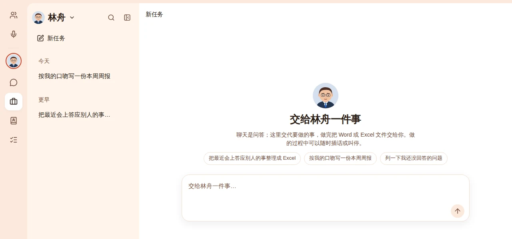
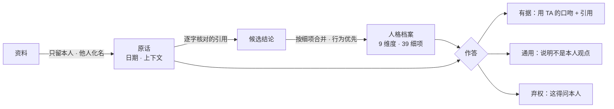
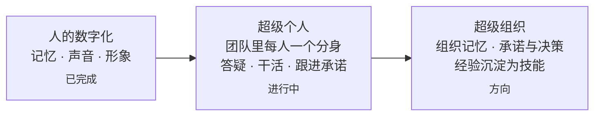

<div align="center">


# twin

**团队的数字分身：从会议里认识每一个人，像本人一样回答。**

团队最真实的知识都在会议里。twin 把会议录音变成每位同事的分身：<br/>
每句话有出处，不知道就说不知道，本人点头才对外。

[快速开始](#快速开始) · [使用指南](docs/GUIDE.md) · [架构](docs/ARCHITECTURE.md) · [对比与评测](docs/COMPARISON.md)

</div>

<p align="center">
  
</p>

<p align="center"><sub><em>团队页：会议里出现过的每个人，以及他们的分身。图中人物和会议都是虚构的。</em></sub></p>

---

## 为什么需要 twin

- **知识在会议里，人却总在忙。** 想问同事一个问题，往往要等 TA 有空。
- **会议纪要只记结论。** 谁怎么想、为什么这么定、答应过什么，往往没有记下来。
- **人走了，经验也走了。** 新同事只能从头再问一遍。

twin 让每位同事都有一个随时在线的分身。它只用本人说过的话回答，答不上来就让你去问本人。

## 它能做什么

### 🎙️ 上传会议，自动认人

同事把会议录音传到团队录音库，twin 转写、分出说话人，按声音认出已知的同事；拿不准的放进「待处理」，试听一句就能确认。接上 GPU 转写服务后，两人同时说话也能分开转写。

### 👤 每人一个分身，归本人

管理员按企业邮箱或工号批量建分身，同事用企业 SSO 登录就认领。先看分身整理出的画像和承诺，本人点「没问题」，同事才能问。还没有分身的人，也可以在会议里找到自己的声音，自己建一个。

<p align="center">
  
</p>

### 💬 像本人一样回答

- **有出处**：每个回答都能展开「依据」，看到引用了哪几句原话、哪一天说的。
- **不编造**：资料里没有的，就用 TA 的口吻说“这得问我本人”。
- **会成长**：会议、笔记、聊天记录、文档、视频都能加进来，增量整理，不用重新训练；删掉的资料，相关结论也跟着更新。

<p align="center">
  
</p>

<p align="center"><sub><em>档案：分身了解到的这个人，按九个方面整理，每条都能查看依据、修改或删除。</em></sub></p>

### 🛠️ 替本人干活

- **工作**：交代一件事，分身按本人的口吻写周报、整理会上答应别人的事，做完交出 Word 或 Excel。
- **承诺账本**：从会议里整理出谁答应了什么、在哪场会上说的。
- **随处可问**：企业微信里单聊或在群里 @ 分身；也能从命令行、HTTP API 和 MCP 调用。

<p align="center">
  
</p>

### 🗣️ 用 TA 的声音说，用 TA 的样子出镜

<table>
  <tr>
    <td width="30%" align="center">
      <a href="docs/assets/talking.mp4"></a>
      <br><sub>▶ <a href="docs/assets/talking.mp4">带声音的视频</a></sub>
    </td>
    <td>

- **声音**：录一段话就能克隆，约 0.5 秒开口。
- **视频**：一张照片加克隆的声音，生成真人口播视频，RTX 3090 上约 25 秒。
- **快**：回答逐字流出，约 1 秒出第一个字。

<sub>默认关闭，配好语音和视频服务后由管理员打开，见 [语音与视频](docs/MEDIA.md)。</sub>

</td>
  </tr>
</table>

## 用数字说话

| | **twin** | 对照 |
| :-- | :-: | :-- |
| 本人资料上的事实准确率 | **98.4%** | Second Me 升级版 78.1% |
| 资料里没有时不编造 | **100%** | Second Me 升级版 70% |
| 像本人（1–5 分） | **4.0** | Second Me 升级版 1.9–2.2 |
| [LongMemEval](https://github.com/xiaowu0162/LongMemEval)：长期记忆 | **94%** | 公开最好 95%（厂商自报） |
| [PersonaMem-v2](https://huggingface.co/datasets/bowen-upenn/PersonaMem-v2)：推断没明说的偏好 | **66%** | 论文最好 55% |

**会议转写**：在公开会议测试集 [AISHELL-4](https://www.openslr.org/111/) 上，整场约 40 分钟的录音直接转写并标出“谁说了什么”（cpCER，越低越好）：

| 系统 | 谁说了什么错字率 |
| :-- | :-: |
| **twin**<br/><sub>3D-Speaker 分人 + MossFormer2 重叠分离 + FireRedASR2</sub> | **16.1%** |
| MOSS-Transcribe-Diarize（在 AISHELL-4 上训练） | 15.8% |
| VibeVoice-ASR | 25.0% |
| Gemini 3 Pro | 27.4% |
| 豆包 | 27.9% |
| ElevenLabs | 38.0% |
| FunASR 1.4.2（SeACo-Paraformer-large + CAM++ 聚类）<br/><sub>twin 上一版的转写</sub> | 26.6% |

> 本人资料一组是作者本人资料上的自建题，twin 用前沿大模型作答，Second Me 用本地小模型。公开基准由 Sonnet 5.5 作答（换成 `gpt-6-luna` 作答时为 75% 和 55%），各家的题量、作答模型和评委都不同，只能看量级；Twin-2K-500 等其余成绩一并列在对比文档里。会议转写的对照数字取自 MOSS-Transcribe-Diarize 技术报告，twin 只用单个远场麦克风，识别模型没有在 AISHELL-4 上训练，方案选定前也没有用过这批数据；分人错误率（DER）twin 为 10.7%，介于 pyannote（11.4%–11.7%）和 DiariZen（9.8%）之间。
>
> 题量、区间、失误分析和迭代走势见 [对比与评测](docs/COMPARISON.md)；会议转写的口径、AliMeeting 上的对照和局限见 [语音识别评测](docs/ASR_EVAL.md#aishell-4-公开成绩对照2026-10-21-检索)。

## 和别的方案有什么不同

| | 智能体记忆<br/><sub>mem0 · Letta · Graphiti · MemOS</sub> | 数字人<br/><sub>Duix · LiveTalking · Fay</sub> | Second Me | **twin** |
| :-- | :-: | :-: | :-: | :-: |
| 记的是“这个人是谁、怎么想、怎么说” | — | — | ✓ | **✓** |
| 每条结论带逐字原话 | 部分 | — | — | **✓** |
| 资料没有就弃权 | — | — | — | **✓** |
| 增删资料不用重训 | ✓ | — | — | **✓** |
| 从团队会议里为每个人建分身，本人认领 | — | — | — | **✓** |
| 克隆声音 + 真人视频 | — | ✓ | — | **✓** |

为什么不在 Second Me 上继续改，见 [对比与评测](docs/COMPARISON.md#先试过升级-second-me为什么另起炉灶)。

## 记忆怎么工作



回答之后还有三道机械检查：引用核对、置信度封顶、引号守卫（找不到出处的“原话”会被去掉引号）。详见 [架构](docs/ARCHITECTURE.md)。

## 权限与隐私

- **本人说了算**：分身归本人和建它的人；本人点头并勾选「同事能问我的分身」之后，同事才能问。对话各自私有。
- **登录**：企业 SSO、twin 账号或邮箱验证码。
- **数据在你手里**：每个分身独立存储，部署在你自己的服务器上；资料发往哪些模型服务由部署决定，并在系统设置里如实列出。

## 路线图



个人分身是底座，组织能力从个人层长出来：个人资料不会自动变成组织资产，要本人发布。

## 快速开始

在自己的 Mac（Apple 芯片）上试：

```bash
git clone -b stable https://cnb.cool/xjjk/opscenter/aihub/twin.git
cd twin
./scripts/local-up.sh
```

首次运行会询问模型服务地址、模型名和密钥（密钥只存在本机的 `.env`），并自动安装会议转写。打开网页，在「团队」上传一段会议录音，确认说话人，就可以和 TA 的分身聊天了。只想先看效果，加 `--demo` 导入虚构示例。

也可以在 Claude Code、Codex 等 AI 助手里打开仓库，说“部署它”，助手会按 [AGENTS.md](AGENTS.md) 执行。

部署给团队、接入企业 SSO 和企业微信，见 [使用指南](docs/GUIDE.md)；参数、自检和会议录音演示见 [本地验证](docs/LOCAL_DEV.md)。

## 文档

| 我想… | 看这里 |
| :-- | :-- |
| 在自己的 Mac 上运行 | [本地验证](docs/LOCAL_DEV.md) |
| 部署给团队、登录、企业微信、导入资料 | [使用指南](docs/GUIDE.md) |
| 了解整体设计 | [架构](docs/ARCHITECTURE.md) · [人格维度](docs/PERSONA_DIMENSIONS.md) |
| 了解各个页面 | [网页界面](docs/WEB_UI.md) |
| 接入语音、视频 | [语音与视频](docs/MEDIA.md) |
| 从其他应用调用分身 | [服务接口](docs/SERVICE.md) |
| 看评测和同类对比 | [对比与评测](docs/COMPARISON.md) · [本人资料评测](docs/PERSONAL_EVAL.md) · [验证与失误分析](docs/BENCHMARK_VALIDATION.md) · [语音识别评测](docs/ASR_EVAL.md) |
| 跑公开基准 | [LongMemEval](docs/LONGMEMEVAL.md) · [PersonaMem-v2](docs/PERSONAMEM2.md) · [Twin-2K-500](docs/TWIN2K500.md) |
| 参与开发 | [契约](docs/CONTRACTS.md) · [网页界面](docs/WEB_UI.md) · [AGENTS.md](AGENTS.md) |
