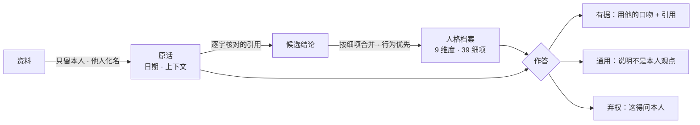
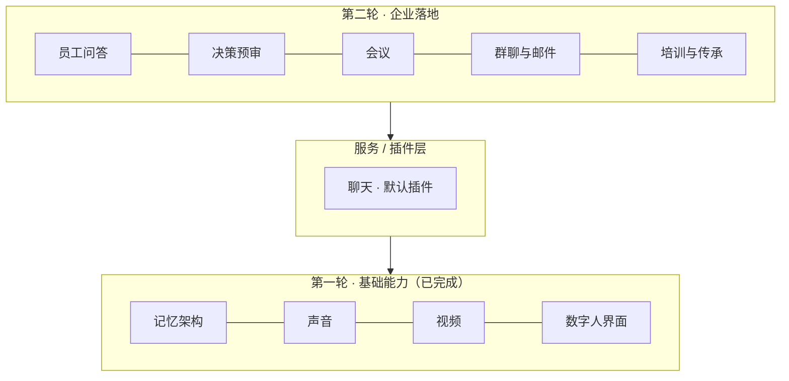

<div align="center">


# twin

**像他一样回答、说话和出镜的个人数字分身。**

从一个人自己的资料里长出来：每句话有出处，不知道就说不知道。

[架构](docs/ARCHITECTURE.md) · [使用指南](docs/GUIDE.md) · [对比与评测](docs/COMPARISON.md) · [LongMemEval](docs/LONGMEMEVAL.md) · [PersonaMem-v2](docs/PERSONAMEM2.md) · [Twin-2K-500](docs/TWIN2K500.md) · [验证与失误分析](docs/BENCHMARK_VALIDATION.md) · [服务接口](docs/SERVICE.md) · [语音与视频](docs/MEDIA.md)

</div>

<p align="center">
  
</p>

<p align="center"><sub><em>示例分身「林舟」：资料是虚构的，人像是作者本人的 3D 形象。</em></sub></p>

---

## 像他一样回答。

*答案只来自他自己的话。*

- **两层记忆 →** 本人原话 + 从原话提炼的人格档案（9 维度、39 细项），每条结论都附逐字核对过的原话和日期。
- **不编 →** 关于本人但资料里没有，就用他的口吻说"这得问我本人"。
- **有出处 →** 每个回答都能展开「依据」，看到引用了哪几句原话。
- **可回溯 →** 能回答"截至某一天，他会怎么说"。

## 用他的声音说，用他的样子出镜。

*点哪句，舞台上的人就说哪句。*

<table>
  <tr>
    <td width="30%" align="center">
      <a href="docs/assets/talking.mp4"></a>
      <br><sub>▶ <a href="docs/assets/talking.mp4">带声音的视频</a>：一张照片 + 本人声音，3090 上 25 秒生成</sub>
    </td>
    <td>

- **声音 →** 录一段话就能克隆，边生成边播放，约 0.5 秒开口。
- **视频 →** 一张照片 + 克隆的声音，生成真人口播视频，在舞台的圆框里播放。
- **快 →** 回答逐字流出，约 1 秒出第一个字。
- **一个声音 →** 「听」和视频用同一个克隆声音，舞台上的人说话前后一致。

</td>
  </tr>
</table>

<table>
  <tr>
    <td width="32%"></td>
    <td></td>
  </tr>
  <tr>
    <td align="center"><sub>手机：人像在上，回答在下</sub></td>
    <td align="center"><sub>档案：他是谁、记得什么、形象和声音，每条都可以确认或修改</sub></td>
  </tr>
</table>

## 把资料交给它。

*文字、文件、录音、视频，放进来就自动整理。*

- **什么都能放 →** 笔记、聊天记录、PDF / Word / 电子书、录音、手机视频，最大 4 GB，断点续传。
- **认出本人 →** 多人录音会区分说话人，自动认出哪位是他，还能从视频里挑声音片段和正脸照片。
- **随时增删 →** 增量整理，不重训；删掉的资料，相关结论也跟着更新。

## 给一群人用。

- **多个分身 →** 一个人可以有多个分身，左上角一键切换，删除后 7 天内可恢复。
- **企业微信 →** 同事在企业微信里单聊或在群里 @ 分身，回答同样逐字流出、附原话依据，语音消息也能问。
- **邮箱验证码登录 →** 允许名单 + 等候名单；同事只看得到自己的分身，对话各自私有。
- **隐私 →** 每个分身独立存储；他人姓名化名；资料发往哪些服务由配置决定，界面如实显示。

---

## 记忆架构



回答之后还有三道机械检查：**引用核对 · 置信度封顶 · 引号守卫**（找不到出处的"原话"会被去掉引号）。完整说明见 [架构](docs/ARCHITECTURE.md)。

## 为什么是 twin

| | 智能体记忆<br/><sub>mem0 · Letta · Graphiti · MemOS</sub> | 数字人<br/><sub>Duix · LiveTalking · Fay</sub> | Second Me | **twin** |
| :-- | :-: | :-: | :-: | :-: |
| 记的是"这个人是谁、怎么想、怎么说" | — | — | ✓ | **✓** |
| 每条结论带逐字原话 | 部分 | — | — | **✓** |
| 资料没有就弃权 | — | — | — | **✓** |
| 增删资料不用重训 | ✓ | — | — | **✓** |
| 克隆声音 + 真人视频 | — | ✓ | — | **✓** |

## 评测

两类评测：作者本人资料上的自建题，看分身像不像这个人；三个公开基准，看记忆和推断偏好的能力，能和别的系统比。

### 本人资料

同一套题（[本人资料评测](docs/PERSONAL_EVAL.md)）：

| | 事实准确率 | 资料没有时不编造 | 像本人（1–5） |
| :-- | :-: | :-: | :-: |
| Second Me 原版 | 4.7% | 10% | 1.0 |
| Second Me 升级版 | 78.1% | 70% | 1.9–2.2 |
| **twin** | **98.4%** | **100%** | **4.0** |

<sub>twin 用前沿大模型作答，Second Me 用本地小模型，差距有一部分来自模型。评委、题量与当前线上模型的结果见 [对比与评测](docs/COMPARISON.md)。</sub>

### 公开基准

越高越好：

| 基准 | 测什么 | **twin** | 公开最好成绩 | Second Me 升级版 |
| :-- | :-- | :-: | :-: | :-: |
| [LongMemEval](https://github.com/xiaowu0162/LongMemEval) | 在多次长对话里记住、更新并推算事实 | 80%<br/><sub>正式集</sub> | **95%**<br/><sub>Mastra，gpt-5-mini 作答，自报</sub> | 0% |
| [PersonaMem-v2](https://huggingface.co/datasets/bowen-upenn/PersonaMem-v2) | 从对话里推断没明说的偏好 | 51%<br/><sub>正式集</sub> | **55%**<br/><sub>作者的代理式记忆，论文</sub> | — |
| [Twin-2K-500](https://huggingface.co/datasets/LLM-Digital-Twin/Twin-2K-500) | 像本人一样答问卷，按达到真人重测的比例计 | 60% | **88%**<br/><sub>GPT-4.1-mini 数字孪生</sub> | 4% |

- **twin 成绩**：都由 `gpt-6-luna` 作答。
  - LongMemEval 和 PersonaMem-v2 是记忆内核 persona-v5（2026-10-12）在正式集上的成绩，跑 3 次取平均。
    - LongMemEval：30 题，每种题型 5 题。3 次在 73%–90% 之间，评委为 `gpt-6.1-sol`。
    - PersonaMem-v2：8 人 201 题。3 次在 50%–52% 之间。
    - 同一内核在开发集上为 LongMemEval 85%（36 题）、PersonaMem-v2 55%（4 人 108 题）。开发集用于日常迭代，题目与正式集不重叠。
    - 2026-10-10 旧代码在 LongMemEval 正式集上为 33%，由作答模型自己评分。
  - Twin-2K-500 是 2026-10-10 代码的正式抽样，10 人。
- **公开成绩**：截至 2026-10，取自各自的论文或博客。题量、作答模型、评委和打分细则都和 twin 不同，只能看量级。LongMemEval 的高分都是厂商自报，还没有独立复现，而且分数随作答模型变化很大。
- **PersonaMem 版本**：已从 v1 换到更难的 v2。twin 在 v1 上是 63%，当时公开成绩约 50%。v2 上前沿大模型直接读全文约 37%–48%（论文）。
- **Twin-2K-500**：暂停迭代。
- **Second Me**：同题小样本，6 题或 2 人。
- **怎么迭代**：每次改动在开发集上跑 3 次，用配对符号检验判断变化是否超出波动。细节见 [验证与失误分析](docs/BENCHMARK_VALIDATION.md)。

## 技术路线



- **第一轮**建底座：记忆、声音、视频、数字人界面，用**聊天**来演示，聊天本身就是默认插件。
- **第二轮**给高管做数字分身，参与企业的日常工作，把高管的判断、经验和表达方式复制出来、放大出去。每个场景一个插件，复用同一套有据的回答契约；对外发出前可以要求本人确认；每个插件过了场景评测才默认开启。

---

## 快速开始

1. 克隆稳定版并进入目录（Mac 需先有 Git 和 uv；缺少 uv 时运行 `brew install uv`）：

   ```bash
   git clone -b stable https://cnb.cool/xjjk/opscenter/aihub/twin.git
   cd twin
   ```

2. 一条命令启动：

   ```bash
   ./scripts/local-up.sh
   ```

   首次运行会在终端询问模型服务地址、模型名和密钥（密钥输入不显示），分别保存到仓库的 `twin.toml` 和 `.env`（0600，均不入 git），以后不再询问。

3. 打开网页后按引导创建你的数字人：**你是谁**（名字和一段介绍）→ **形象和声音**（可跳过；上传一段本人录音，会议录音里认人更准）→ **添加记忆**（会议录音、聊天记录、文档）→ **聊天**。会议录音转写完成后，在“记忆”页试听说话人，勾选属于你的（可多选），确认后自动整理进记忆。按 Ctrl-C 停止服务。

   只想先看效果时，可加 `--demo` 导入虚构示例“示例·林舟”。

**默认开启文字聊天和会议录音转写**：首次运行自动安装 ffmpeg 与本机转写包（约 2.0 GiB 模型，已有则复用；`--no-asr` 跳过）。朗读真人音色和口型视频默认关闭，需要时再配置 `[tts]` / `[video]`，见 [媒体配置](docs/MEDIA.md)。

更新：`stable` 分支每次运行 `./scripts/local-up.sh` 都会自动更新到最新稳定版；数据库迁移和记忆内核重新整理由应用自动完成，整理前自动快照，可以回退。本地数据默认只在本机仓库 `data/`，与官方演示环境互不影响。

在 Claude Code、Codex 等 AI 助手里打开仓库，说“部署它”即可，助手按 [AGENTS.md](AGENTS.md) 执行；密钥请自己填写在 `.env`，不要发到对话里。

参数、自检、示例提问和会议录音演示见 [协作者本地验证](docs/LOCAL_DEV.md)，转写细节见[会议录音转写](docs/LOCAL_DEV.md#会议录音转写默认开启)。命令行、API、MCP、公网部署和邮箱登录见 [使用指南](docs/GUIDE.md)。

## 文档

| 我想… | 看这里 |
| :-- | :-- |
| 在自己的 Mac 上运行验证 | [协作者本地验证](docs/LOCAL_DEV.md) |
| 了解整体怎么搭起来的 | [架构](docs/ARCHITECTURE.md) · [人格维度](docs/PERSONA_DIMENSIONS.md) |
| 部署、导入资料、开启登录 | [使用指南](docs/GUIDE.md) |
| 接入语音、视频、数字人 | [语音与视频](docs/MEDIA.md) |
| 从其他应用调用分身 | [服务接口](docs/SERVICE.md) |
| 看评测数据和同类对比 | [对比与评测](docs/COMPARISON.md) · [本人资料评测](docs/PERSONAL_EVAL.md) · [验证与失误分析](docs/BENCHMARK_VALIDATION.md) |
| 跑公开基准 | [LongMemEval](docs/LONGMEMEVAL.md) · [PersonaMem-v2](docs/PERSONAMEM2.md) · [Twin-2K-500](docs/TWIN2K500.md) |
| 改代码 | [契约](docs/CONTRACTS.md) · [网页界面](docs/WEB_UI.md) |

## 开发

```bash
pnpm -C frontend install && pnpm -C frontend build   # 前端产物随 Python 包分发
pnpm -C frontend typecheck && pnpm -C frontend lint && pnpm -C frontend test
uv run python scripts/check.py          # 改动中：只跑受影响的测试
uv run python scripts/check.py --full   # 提交前：全部检查，与 CI 一致
```

内核在 `main` 上迭代，确认后运行 `./scripts/release-stable.sh` 发布给同事（只快进 `stable`）。开发时 `uv run twin ui` 起后端，`pnpm -C frontend dev` 起前端（`/api` 代理到后端）。细节见 [网页界面](docs/WEB_UI.md)。
