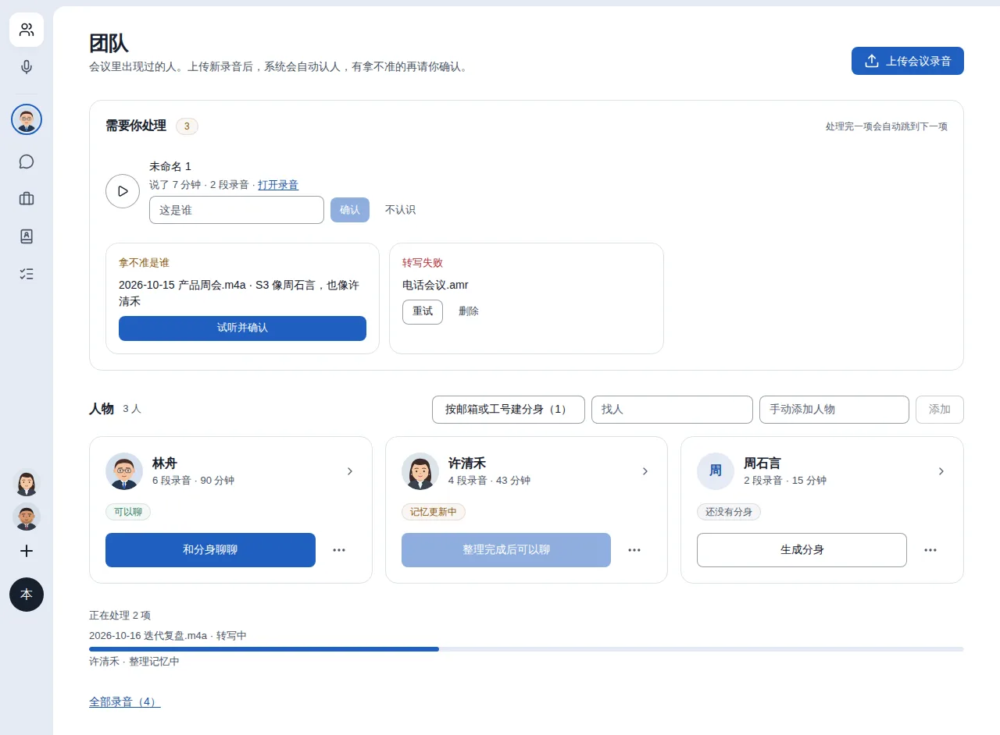
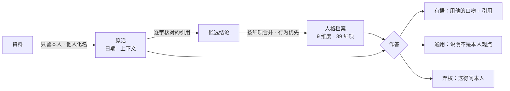
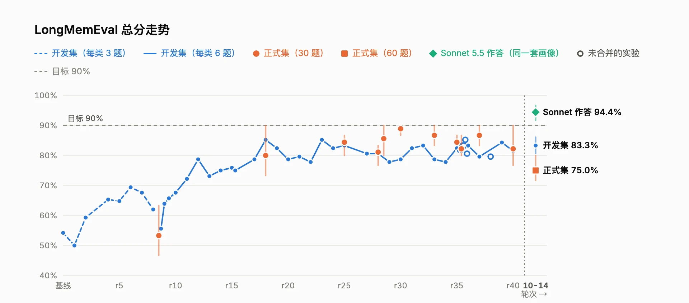
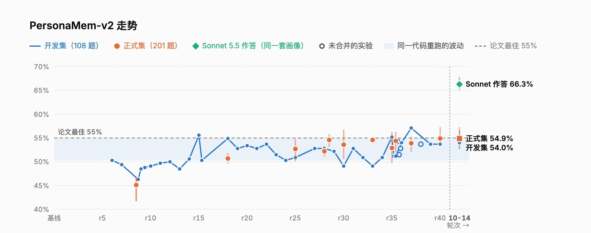
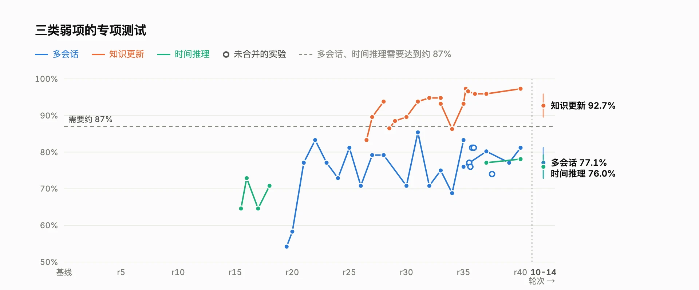
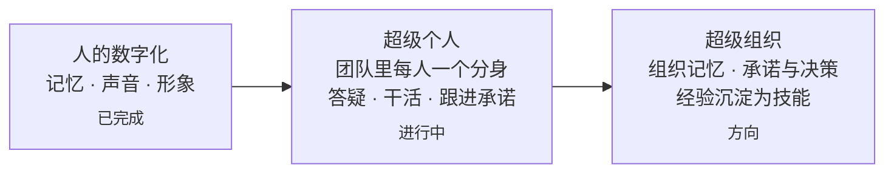

<div align="center">


# twin

**团队的数字分身：从会议里认识每一个人，像本人一样回答。**

人的数字化 → 超级个人 → 超级组织。每句话有出处，不知道就说不知道。

[架构](docs/ARCHITECTURE.md) · [使用指南](docs/GUIDE.md) · [网页界面](docs/WEB_UI.md) · [对比与评测](docs/COMPARISON.md) · [LongMemEval](docs/LONGMEMEVAL.md) · [PersonaMem-v2](docs/PERSONAMEM2.md) · [验证与失误分析](docs/BENCHMARK_VALIDATION.md) · [服务接口](docs/SERVICE.md) · [语音与视频](docs/MEDIA.md)

</div>

<p align="center">
  
</p>

<p align="center"><sub><em>团队页：会议里出现过的人、拿不准要你确认的声音、每个人的分身。图中人物和会议都是虚构的。</em></sub></p>

---

## 从会议里认识每个人。

*同事把会议录音传上来，系统认出谁说了什么。*

- **一个团队录音库 →** 大家上传的会议录音汇到同一个库，同一场会两个人都传了只算一次。录音由上传的同事和管理员整理，其他人只能在自己的发言上点「不是我」。
- **自动认人 →** 区分说话人，按声音认出已知的同事。拿不准的放进「需要你处理」：就地试听一句，输入是谁，回车确认并跳到下一项。
- **人物 →** 团队页列出会议里出现过的每个人，说了多久、出现在几段录音里。同名的两个人不会被自动合并，由管理员决定合并还是分开。
- **承诺账本 →** 从会议里整理出谁答应了什么、在哪场会上说的。

## 每个人一个分身，归本人。

*管理员替大家建好，本人登录就认领，点头之后才对外。*

- **批量建 →** 在团队页按企业邮箱或工号，一次为多位同事建分身。分身从 TA 在会议里说过的话长出来。
- **登录即认领 →** 同事用企业 SSO 登录，工号和建分身时填的对上，分身就归到 TA 名下；SSO 以后带上邮箱，邮箱也一样能对上。
- **本人点头才对外 →** 认领后先看分身整理出的承诺和画像，可以先试聊几句。点「没问题」之前，其他同事问不到它；点「这不是我」，分身退回给建它的人，在「需要你处理」里换一个邮箱或工号。
- **没人建也能自己找 →** 还没有分身的同事登录后读一句话，在同事上传的会议里认出自己的声音，用确认过的发言建分身。会议里没有，就先建一个空分身，自己介绍、加资料。

## 像本人一样回答。

*答案只来自 TA 自己的话。*

- **两层记忆 →** 本人原话 + 从原话提炼的人格档案（9 维度、39 细项），每条结论都附逐字核对过的原话和日期。
- **不编 →** 关于本人但资料里没有，就用 TA 的口吻说“这得问我本人”。
- **有出处 →** 每个回答都能展开「依据」，看到引用了哪几句原话。
- **可回溯 →** 能回答“截至某一天，TA 会怎么说”。
- **资料不止会议 →** 笔记、聊天记录、PDF / Word / 电子书、录音、手机视频都能放，最大 4 GB，断点续传；增量整理，不重训，删掉的资料相关结论也跟着更新。

<table>
  <tr>
    <td width="32%"></td>
    <td></td>
  </tr>
  <tr>
    <td align="center"><sub>手机：人像在上，回答在下</sub></td>
    <td align="center"><sub>聊天：回答逐字流出，约 1 秒出第一个字，每条都能展开依据</sub></td>
  </tr>
</table>

<p align="center"><sub><em>示例分身「林舟」：资料是虚构的，人像是作者本人的 3D 形象。</em></sub></p>

## 替本人干活。

- **工作 →** 交代一件事，工作智能体可以上网搜索、读网页，任务列表放在左侧。
- **企业微信 →** 同事在企业微信里单聊或在群里 @ 分身，回答同样逐字流出、附原话依据，语音消息也能问。
- **从其他应用调用 →** 命令行、HTTP API 和 MCP，见 [服务接口](docs/SERVICE.md)。

## 用 TA 的声音说，用 TA 的样子出镜。

*默认关闭：配好语音和视频服务后，管理员在系统设置里打开。*

<table>
  <tr>
    <td width="30%" align="center">
      <a href="docs/assets/talking.mp4"></a>
      <br><sub>▶ <a href="docs/assets/talking.mp4">带声音的视频</a>：一张照片 + 本人声音，3090 上 25 秒生成</sub>
    </td>
    <td>

- **声音 →** 录一段话就能克隆，边生成边播放，约 0.5 秒开口。
- **视频 →** 一张照片 + 克隆的声音，生成真人口播视频，在舞台的圆框里播放。
- **快 →** 回答逐字流出，约 1 秒出第一个字。
- **一个声音 →** 「听」和视频用同一个克隆声音，舞台上的人说话前后一致。

</td>
  </tr>
</table>

<table>
  <tr>
    <td width="32%"></td>
    <td></td>
  </tr>
  <tr>
    <td align="center"><sub>手机：人像在上，回答在下</sub></td>
    <td align="center"><sub>档案：他是谁、记得什么、形象和声音，每条都可以确认或修改</sub></td>
  </tr>
</table>

## 权限与隐私

- **登录 →** 企业 SSO，或邮箱验证码（允许名单 + 等候名单）。管理员能看到全部；服务状态、模型、密钥和额度只在管理员的「系统设置」里。
- **可见范围 →** 分身归本人和建它的人；本人点「没问题」并勾选「同事能问我的分身」之后，同事才能问。对话各自私有。
- **存储 →** 每个分身独立存储；资料发往哪些模型和语音服务由部署配置决定，系统设置里如实列出。

---

## 记忆架构



回答之后还有三道机械检查：**引用核对 · 置信度封顶 · 引号守卫**（找不到出处的"原话"会被去掉引号）。完整说明见 [架构](docs/ARCHITECTURE.md)。

## 为什么是 twin

| | 智能体记忆<br/><sub>mem0 · Letta · Graphiti · MemOS</sub> | 数字人<br/><sub>Duix · LiveTalking · Fay</sub> | Second Me | **twin** |
| :-- | :-: | :-: | :-: | :-: |
| 记的是“这个人是谁、怎么想、怎么说” | — | — | ✓ | **✓** |
| 每条结论带逐字原话 | 部分 | — | — | **✓** |
| 资料没有就弃权 | — | — | — | **✓** |
| 增删资料不用重训 | ✓ | — | — | **✓** |
| 从团队会议里为每个人建分身，本人认领 | — | — | — | **✓** |
| 克隆声音 + 真人视频 | — | ✓ | — | **✓** |

## 评测

两类评测：作者本人资料上的自建题，看分身像不像这个人；三个公开基准，看记忆和推断偏好的能力，能和别的系统比。

### 本人资料

同一套题（[本人资料评测](docs/PERSONAL_EVAL.md)）：

| | 事实准确率 | 资料没有时不编造 | 像本人（1–5） |
| :-- | :-: | :-: | :-: |
| Second Me 原版 | 4.7% | 10% | 1.0 |
| Second Me 升级版 | 78.1% | 70% | 1.9–2.2 |
| **twin** | **98.4%** | **100%** | **4.0** |

<sub>twin 用前沿大模型作答，Second Me 用本地小模型，差距有一部分来自模型。评委、题量与当前线上模型的结果见 [对比与评测](docs/COMPARISON.md)。</sub>

### 公开基准

越高越好：

| 基准 | 测什么 | **twin**<br/><sub>gpt-6-luna 作答</sub> | **twin**<br/><sub>Sonnet 5.5 作答</sub> | 公开最好成绩 | Second Me 升级版 |
| :-- | :-- | :-: | :-: | :-: | :-: |
| [LongMemEval](https://github.com/xiaowu0162/LongMemEval) | 在多次长对话里记住、更新并推算事实 | 75% | 94% | **95%**<br/><sub>Mastra，gpt-5-mini 作答，自报</sub> | 0% |
| [PersonaMem-v2](https://huggingface.co/datasets/bowen-upenn/PersonaMem-v2) | 从对话里推断没明说的偏好 | 55% | 66% | **55%**<br/><sub>作者的代理式记忆，论文</sub> | — |
| [Twin-2K-500](https://huggingface.co/datasets/LLM-Digital-Twin/Twin-2K-500) | 像本人一样答问卷，按达到真人重测的比例计 | 60% | — | **88%**<br/><sub>GPT-4.1-mini 数字孪生</sub> | 4% |

- **twin 成绩**：LongMemEval 和 PersonaMem-v2 是记忆内核 persona-v5（2026-10-14，第 40 轮）在正式集上的成绩，跑 3 次取平均，评委为 `gpt-6.1-sol`。
  - **两种作答模型**：画像都由 `gpt-6-luna` 构建，两种作答用的是同一套画像，只换掉回答问题的模型。部署时可以用 `[chat_llm]` 单独给回答配一个更强的模型，画像仍用 `[llm]` 构建。Anthropic 不向总部在中国大陆或大陆控股的公司提供服务，能否用 Sonnet 作答取决于部署方。
  - **LongMemEval**：60 题，每种题型 10 题。
    - `gpt-6-luna` 作答 75%，3 次在 72%–80% 之间。
    - Sonnet 5.5 作答 94%，3 次在 92%–97% 之间。多会话从 43% 提到 83%，时间推理从 63% 提到 93%。
    - 其中 8 题在扩到 60 题之前被开发集抽到过；去掉这 8 题后两者分别是 74% 和 95%。此后开发集不再抽到正式题。
    - 此前的正式集是每种题型 5 题共 30 题，第 40 轮用 `gpt-6-luna` 作答为 82%；题量翻倍后降到 75%，30 题的成绩偏乐观。
    - 2026-10-10 旧代码在 30 题正式集上为 33%，由作答模型自己评分。
  - **PersonaMem-v2**：8 人 201 题。`gpt-6-luna` 作答 55%，3 次在 54%–57% 之间；Sonnet 5.5 作答 66%，3 次在 65%–68% 之间。
  - **开发集**用于日常迭代，题目与正式集不重叠。第 40 轮在开发集上为 LongMemEval 83%（36 题，3 次在 81%–86% 之间）、PersonaMem-v2 54%（4 人 108 题，3 次在 53%–57% 之间），都由 `gpt-6-luna` 作答。开发集 2026-10-14 起换成不含任何正式题的新抽样，和此前的开发集数字不能直接比。
  - **Twin-2K-500** 是 2026-10-10 代码的正式抽样，10 人，`gpt-6-luna` 作答。
- **公开成绩**：截至 2026-10，取自各自的论文或博客。题量、作答模型、评委和打分细则都和 twin 不同，只能看量级，不能直接比高低。LongMemEval 的高分都是厂商自报，还没有独立复现，而且分数随作答模型变化很大。
- **PersonaMem 版本**：已从 v1 换到更难的 v2。twin 在 v1 上是 63%，当时公开成绩约 50%。v2 上前沿大模型直接读全文约 37%–48%（论文）。
- **Twin-2K-500**：暂停迭代。
- **Second Me**：同题小样本，6 题或 2 人。
- **怎么迭代**：每次改动在开发集上跑 3 次，用配对符号检验判断变化是否超出波动。细节见 [验证与失误分析](docs/BENCHMARK_VALIDATION.md)。

### 会议转写

用公开的多人会议录音 [AliMeeting](https://www.openslr.org/119/)（远场，只取单个麦克风），测上传录音后记到本人名下的文字有多准。Test 共 20 场、48 人次，越低越好：

| | 本人话语错字率 | 本人的话漏掉 | 整场错字率 | 分人错误率（DER） | 别人的话记到本人名下 |
| :-- | :-: | :-: | :-: | :-: | :-: |
| 线上转写（FunASR） | 27.96% | 21.22% | 32.49% | 23.55% | 3.57% |
| **重叠感知转写**<br/><sub>3D-Speaker 分人 + 重叠分离 + FireRedASR2</sub> | **17.63%** | **9.41%** | **24.98%** | **10.26%** | 4.83% |

<sub>逐人次比较，48 人次里 45 人次变好、2 人次变差（符号检验 p < 10⁻¹⁰）。这里的 Test 在比较方案时看过，只能算开发集。识别、分离和声纹模型都没在 AliMeeting 上训练，比榜单上用 8 麦克风阵列、在 AliMeeting 上训练的系统条件更难。</sub>

方案定下后，在从没用过的 [AISHELL-4](https://www.openslr.org/111/) 测试集上只验证了一次（20 场、12.7 小时、116 人次，每场 4–8 人）：

| | 本人话语错字率 | 本人的话漏掉 | 整场错字率 | 分人错误率（DER） | 别人的话记到本人名下 |
| :-- | :-: | :-: | :-: | :-: | :-: |
| 线上转写（FunASR） | 23.16% | 12.31% | 21.07% | 14.43% | 2.42% |
| **重叠感知转写**（asr-funasr 1.4.0） | **16.08%** | **5.31%** | **15.12%** | **4.84%** | 3.72% |

<sub>本人一列按选对说话人计算（相当于用户手动选对）；116 人次里 97 人次变好、16 人次变差（p < 10⁻¹⁴），20 场的整场错字率和 DER 全部变好。这批录音只有远场阵列，参考声音也只能取远场，自动认领会把同屋其他人一起认成本人，新旧流程都是如此，认领门槛需要另外按远场参考校准。与公开成绩的逐项对照、方法、三套方案的对比与局限见 [语音识别评测](docs/ASR_EVAL.md#个人上传路径三套分人方案对比2026-10-21)。</sub>

### 迭代走势

蓝线是开发集，橙色圆点是正式集（每种题型 5 题的 30 题版），竖线是同一代码跑 3 次的范围，空心点是没有合并的实验，都由 `gpt-6-luna` 作答。最右边虚线后的“10-14”是新口径：开发集换成不含任何正式题的新抽样，橙色方块是扩大后的正式集（LongMemEval 60 题），绿色菱形是同一套画像改由 Sonnet 5.5 作答。新口径和左边的折线不能直接比。





薄弱题型单独加题复测：多会话、知识更新、时间推理各 48–73 题，每题跑 2 次，`gpt-6-luna` 作答。题量扩大处折线断开；“10-14”是新开发集上各 48 题的基线。



## 技术路线



- **人的数字化**是底座：有据可查的个人记忆、克隆声音、真人视频和数字人界面，用聊天来演示。
- **超级个人**是现在的团队版：会议录音汇成团队录音库，从里面为每个人建分身，本人认领、点头后对同事开放；分身替本人答疑、在「工作」里办事、在承诺账本里跟进答应过的事，企业微信里也能问。
- **超级组织**从个人层长出来，不另造一套平台：个人层的对象（归属人、可见范围、对谁的承诺、证据、状态）设计时就能升到组织层；个人资料不会自动变成组织资产，要本人发布；分身用第一人称替本人说话，系统助手给的事实和建议与之分开。

---

## 快速开始

团队使用：部署到服务器并接入企业 SSO，见 [使用指南](docs/GUIDE.md)。先在自己的 Mac 上试：

1. 克隆稳定版并进入目录（Mac 需先有 Git 和 uv；缺少 uv 时运行 `brew install uv`）：

   ```bash
   git clone -b stable https://cnb.cool/xjjk/opscenter/aihub/twin.git
   cd twin
   ```

2. 一条命令启动：

   ```bash
   ./scripts/local-up.sh
   ```

   首次运行会在终端询问模型服务地址、模型名和密钥（密钥输入不显示），分别保存到仓库的 `twin.toml` 和 `.env`（0600，均不入 git），以后不再询问。

3. 打开网页，在「团队」上传会议录音。转写完成后系统认出说话人，拿不准的在「需要你处理」里试听确认；给某个人点「生成分身」，整理完就能和 TA 的分身聊天。也可以点左侧的 ＋ 给自己建一个分身，按引导介绍自己、加资料。按 Ctrl-C 停止服务。

   只想先看效果时，可加 `--demo` 导入虚构示例“示例·林舟”。

**默认开启文字聊天和会议录音转写**：首次运行自动安装 ffmpeg 与本机转写包（约 2.0 GiB 模型，已有则复用；`--no-asr` 跳过）。朗读真人音色和口型视频默认关闭，需要时再配置 `[tts]` / `[video]`，见 [媒体配置](docs/MEDIA.md)。

更新：`stable` 分支每次运行 `./scripts/local-up.sh` 都会自动更新到最新稳定版；数据库迁移和记忆内核重新整理由应用自动完成，整理前自动快照，可以回退。本地数据默认只在本机仓库 `data/`，与线上环境互不影响。

在 Claude Code、Codex 等 AI 助手里打开仓库，说“部署它”即可，助手按 [AGENTS.md](AGENTS.md) 执行；密钥请自己填写在 `.env`，不要发到对话里。

参数、自检、示例提问和会议录音演示见 [协作者本地验证](docs/LOCAL_DEV.md)，转写细节见[会议录音转写](docs/LOCAL_DEV.md#会议录音转写默认开启)。命令行、API、MCP、公网部署和登录见 [使用指南](docs/GUIDE.md)。

## 文档

| 我想… | 看这里 |
| :-- | :-- |
| 在自己的 Mac 上运行验证 | [协作者本地验证](docs/LOCAL_DEV.md) |
| 部署给团队、开启 SSO 或邮箱登录、导入资料 | [使用指南](docs/GUIDE.md) |
| 了解整体怎么搭起来的 | [架构](docs/ARCHITECTURE.md) · [人格维度](docs/PERSONA_DIMENSIONS.md) |
| 了解团队页、录音库、认领和各页面的接口 | [网页界面](docs/WEB_UI.md) |
| 接入语音、视频、数字人 | [语音与视频](docs/MEDIA.md) |
| 从其他应用调用分身 | [服务接口](docs/SERVICE.md) |
| 看评测数据和同类对比 | [对比与评测](docs/COMPARISON.md) · [本人资料评测](docs/PERSONAL_EVAL.md) · [验证与失误分析](docs/BENCHMARK_VALIDATION.md) |
| 跑公开基准 | [LongMemEval](docs/LONGMEMEVAL.md) · [PersonaMem-v2](docs/PERSONAMEM2.md) · [Twin-2K-500](docs/TWIN2K500.md) |
| 改代码 | [契约](docs/CONTRACTS.md) · [网页界面](docs/WEB_UI.md) |

## 开发

```bash
pnpm -C frontend install && pnpm -C frontend build   # 前端产物随 Python 包分发
pnpm -C frontend typecheck && pnpm -C frontend lint && pnpm -C frontend test
uv run python scripts/check.py          # 改动中：只跑受影响的测试
uv run python scripts/check.py --full   # 提交前：全部检查，与 CI 一致
```

内核在 `main` 上迭代，确认后运行 `./scripts/release-stable.sh` 发布给同事（只快进 `stable`）。开发时 `uv run twin ui` 起后端，`pnpm -C frontend dev` 起前端（`/api` 代理到后端）。细节见 [网页界面](docs/WEB_UI.md)。
