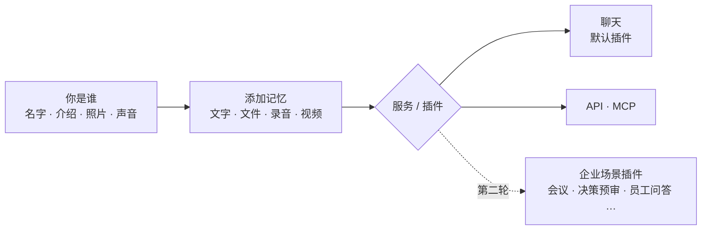
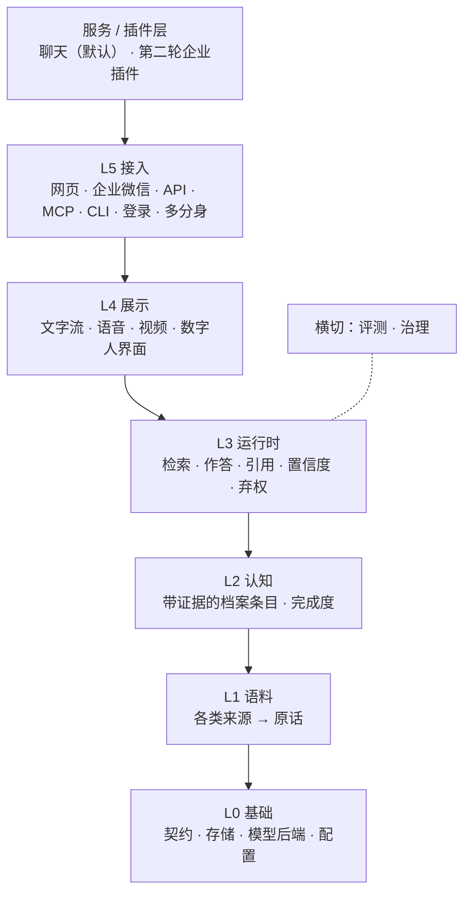
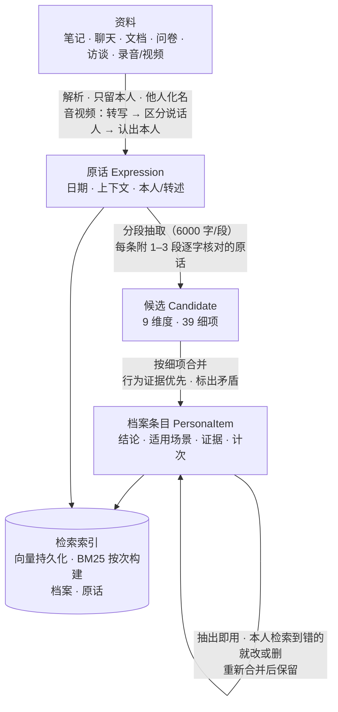
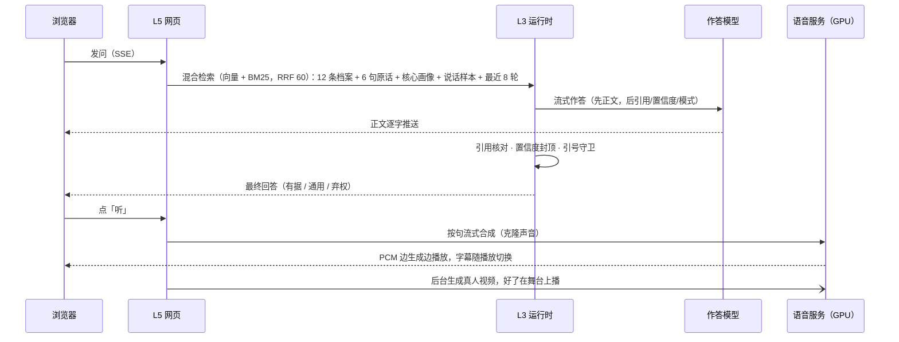
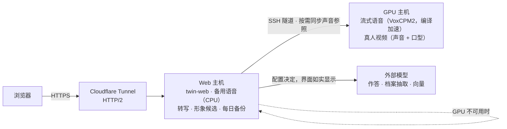
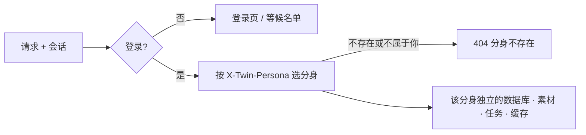

# twin 架构

## 1. 产品形态

回答的**内容**只来自 L3 运行时；声音、形象、视频只是呈现通道，不生成新内容。

## 2. 分层

| 层 | 代码层号（只用于 `tests/test_layers.py`） | 主要模块 |
| --- | --- | --- |
| L0 | 0 工具 · 1 契约 · 2 后端与配置 · 3 存储 | `util` `assets` `persona.lexical` · `persona.schema/items/dimensions` `media.schema` · `llm` `embed` `config` `websearch` `media.tts/asr` · `persona.store` |
| L1 | 4 | `persona.sources` `persona.questionnaire` `persona.quotes` |
| L2 | 5 | `persona.profile` `persona.coverage` `persona.ledger`（承诺账本） `persona.followups`（弃权回流） `persona.transcripts`（转写稿认领本人） `persona.office`（Word/Excel 交付） |
| L3 | 6 | `persona.chat` |
| L4 | 7 | `media.*`（脚本、语音文本、流式、渲染、视频、音视频入库、认人）`service` `persona.work`（工作模式：Deep Agents 干活、交付文件） |
| 评测 | 8 | `evals.*` `media.check` |
| L5 | 9 | `cli` `web.*` `channels.wecom` `frontend/` `api` `mcp_server` |

## 3. 记忆：从资料到档案

- **增量、可重放**：分段、候选、条目的编号都是内容哈希；只抽新分段和分段缺的细项（分类新增、拆分或本人新授权的细项单独补抽），只重合并候选或定义变了的细项，输出逐细项增删改。
- **可按日期作答**：证据都带日期，`as_of` 只用那天之前的证据。
- **不用逐条确认**：条目抽出来就用；本人按意思检索（`GET /api/persona/items/search`，和聊天同一套混合检索），或在聊天回答的依据上，把错的改掉或删掉。有本人原话或本人改过的条目照常作答，只有别人转述的条目封顶 0.6；证据矛盾的条目可以单独看。
- **触发**：资料增删、身份修改都会排队重建；服务启动时自动续上未完成的整理和转写。

- **内核版本**：schema、prompt、taxonomy 分别控制数据库迁移、分段重抽与细项重合并；内核升级可自动整理，超过费用闸时等待确认。细项编号变化时，打开数据库就按 `kernel.TAXONOMY_MIGRATIONS` 把条目和审核记录挪到新编号，整理完成前档案照常可读；较旧的代码（同样带这套机制的）读到不认识的细项时跳过，不报错。

## 4. 作答：一次聊天的路径

| 模式 | 何时 | 置信度上限 |
| --- | --- | --- |
| 有据 | 本人的观点、经历、做法，资料里有 | 只引用别人的转述（本人没说过也没改过）时 0.6 |
| 通用 | 与本人无关的知识和方法 | 0.5 |
| 弃权 | 关于本人但资料里没有；替本人承诺；评价具体他人 | 0.3 |

**工作模式**（`persona.work`，网页「工作」）和聊天分开：聊天是上面这条受控的问答路径，工作是一个 LangChain Deep Agents 循环，按步骤调用工具、交付文件，同样以本人第一人称说话。每一轮先用聊天模型判断一下：只是在问本人的看法、经历、做法（不用做出东西）的话，直接走聊天那条路回答，引用、原话、置信度照样核对，回复下面有依据，也照样转到待回答；要写、要整理、要改文件或拿不准时才交给智能体。智能体的提示词带着和聊天一样的核心画像和说话样本，回复对方时像本人发消息，只有交付文件才按文档的样子写。其余关于本人的内容只能来自 `recall`（就是聊天的检索，本人自己的任务带上承诺账本），`write_word` / `write_excel` 交付 Office 文件，`web_search` / `read_web_page` 查外面的事实（`websearch`，走 DeepSeek 的搜索和读网页接口，网页由 DeepSeek 抓取，链接不经本机网络；`[search]` 有密钥时才提供，没设 `TWIN_SEARCH_KEY` 时沿用同一地址（协议、主机、端口都相同）的聊天模型密钥，密钥只走 HTTPS；读网页只能打开本轮搜索结果和对方消息里的链接，网上内容标明只当资料，免得网页诱导智能体把记忆塞进链接带出去；没有搜索时提示词让它照实说查不了；关于本人的事仍只用 `recall`），Deep Agents 自带的文件工具只能在该任务的目录里读写（虚拟根目录，没有 shell）。本人和访客都能用；访客的任务看不到账本和待回答的问题，每人只看得到自己的任务。任务存在库旁边的 `work/<task_id>/`，每一轮作为后台任务运行；做的过程中可以插话（下一步就交给模型，快收尾时来的话也会在这一轮答复）或叫停（在下一步停下，已经写好的文件保留）。网页上工作页和聊天页是同一套布局：宽屏左边是可收起、可拖宽的任务列表，中间对话，底部输入框；手机上任务列表从顶栏打开。需要能调用工具的模型服务（openai_compat 或 anthropic），claude_cli 不支持。

## 5. 部署（参考）

GPU 主机不可用时，语音和视频自动退回 Web 主机，只是更慢。

## 6. 多分身与权限

- 管理员管理全部分身；成员只管理自己的，默认最多 3 个。对话记录按登录的人隔离，管理员也看不到成员的对话。
- 每个分身一个目录（`personas/p-<id>/`，0700）；删除先进回收站，7 天内可恢复。
- 切换分身不重载页面：先预取新分身的资料和头像，再一次性切换；旧分身的播放和生成随之停止。
- 真人视频只用该分身自己的照片和声音，不会回退到别人的素材。

## 7. 层间规则

1. 依赖只向下，同层无环；新模块先在 `tests/test_layers.py` 登记。
2. 上游不知道下游：运行时不导入展示。
3. 每个边界一个契约 + 适配器：`Expression`（L1→L2）、档案条目（L2→L3）、`ChatReply` → `PresentableAnswer` / `ServiceAnswer`（L3→L4）、`SpeechSynthesizer` / `SpeechRecognizer`（L4→后端）、`SystemUnderTest`（评测）。
4. 契约变化记在 [CONTRACTS.md](CONTRACTS.md)；旧数据库仍可打开。
5. 后端用 `capabilities` 声明能力，上层据此选路径。
6. 错误统一转换，日志不含密钥、地址和原文。
7. 后端只经工厂构造；配置只写环境变量名，不写密钥。
8. 每个边界一套一致性测试，不联网。

## 8. 治理

- **证据优先**：没有逐字原话的结论不进档案；引用不到就降置信度或弃权。
- **本人同意**：用谁的脸和声音，须经其本人同意。
- **出境由配置决定**：配置了外部后端就是本人的选择，界面如实标出；转发到外部的本机代理要声明 `egress = "external"`。
- **他人保护**：他人姓名化名，对他人的评价不进档案。

## 9. 评测

- 用**本人真实资料**的题库：事实、资料里没有的问题、口吻、通用、记忆更新；题库和资料都在仓库外。
- 评委团、重复作答、按来源分组的置信区间、每次运行留来源记录；命令与口径见 [PERSONAL_EVAL.md](PERSONAL_EVAL.md)。
- 媒体另有回听评测（`twin media check`）：合成 → 识别 → 字错率。

## 10. 插件与路线

- **风格改写（L3，默认关闭）**：只改措辞不增删事实，改写后重新核对引用；LoRA 等只能这样接入，过评测才开。
- **外部接入**：其他应用经 API/MCP 用回答契约，业务规则不进分身内核。
- **路线**：第一轮建底座（记忆、声音、视频、数字人界面），用聊天演示；第二轮在服务／插件层做企业落地。见 README 的「技术路线」。
