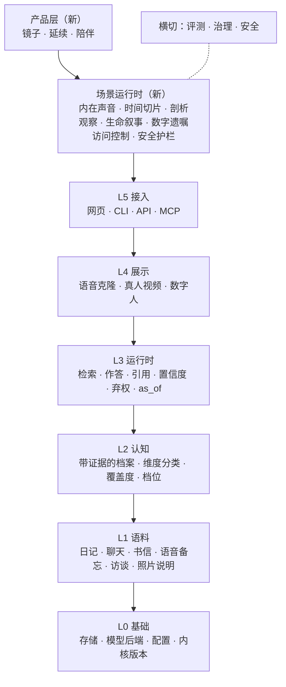

# Persona Agent：产品形态重设计（草案 v0.1）

> 状态：讨论稿，2026-10-29。seasonsolt/twin 从 xjjk/twin（企业协同、团队分身）分化出来，走 Persona Agent 方向。
> 本文只定产品形态和分层，不改代码。第 8 节是已定的决定，第 9 节是 P0、P1 的详细计划。

## 1. 一句话

**为一个人保存可延续的自我：活着时是看清自己的镜子，身后是家人还能对话的那个人。**

同类产品（AI 伴侣、个人助理、"第二大脑"）的目标是让日常生活和工作更顺手。我们不做效率。
我们关心三件事：

| 场景 | 用户此刻想要什么 | 谁在用 |
| --- | --- | --- |
| **自我剖析** | 看清"我是谁、我在逃避什么、我想留下什么" | 本人（在世） |
| **赛博永生** | 我的记忆、价值、说话方式在我之后仍连续存在 | 本人建，身后由指定的人访问 |
| **虚拟陪伴** | 再听到那个声音；和过去的自己或逝去的人说话 | 本人、指定的亲人 |

三者其实是**同一个人的记忆在不同时间被不同的人使用**，所以底层只有一个分身，不是三个产品。

## 2. 哲学依据如何变成产品机制

四个依据：洛克（人是谁）、贝克尔（人为什么想留下来）、杰恩斯（内在声音的结构）、弗洛伊德（怎样分析自己）。
哲学在这里不是宣传语。每一条都要落到一个**可以检查的机制**，落不到的就不写进产品。

### 2.1 洛克：人格同一性 = 记忆的连续性

洛克（《人类理解论》第二卷第 27 章）认为，"同一个人"不由身体或实体决定，而由意识向过去延伸到哪里决定：
你能把哪些过去的思想和行为认作"我的"，你就延伸到哪里。他还说"人格"是一个**法庭用语**：它关系到为自己的行为负责。

| 洛克的论点 | 产品机制 | 现有基础 |
| --- | --- | --- |
| 同一性来自记忆，而非载体 | 分身的"身份"就是带日期、带原话的记忆链；没有证据的结论不进入身份 | 证据优先的档案条目（L2） |
| 只有被意识"据为己有"（appropriation）的才是我 | 本人原话 / 本人确认的条目构成身份；别人的转述只是"别人眼中的我" | 本人原话 vs 他人转述，转述封顶 0.6 |
| 人格是法庭概念：为自己的行为负责 | 分身不替本人做没做过的承诺，不编造没有的经历 | 弃权模式、引用核对、引号守卫 |
| 记忆有断裂（里德"勇敢军官"反驳：传递性会断） | **时间切片**：可以和"2019 年的我"对话，各时期的我可以不一致，而不是抹平成一个平均人 | `as_of` 只用当天以前的证据 |
| 复制品问题（同时存在两个"我"？） | 产品永远不宣称"它就是你"；称为"你的记忆延续"，界面如实标注 | 治理：如实标注（需新增） |

**推论**：记忆内核的质量就是"永生"的质量。连续性有缺口的地方（某几年没有资料）要在界面上可见，
而不是让模型自行补全——补出来的不是这个人。

### 2.2 贝克尔：死亡否认与不朽工程

贝克尔（《拒斥死亡》，1973）认为，人的大部分文化行为都是在对抗对死亡的恐惧：
我们构建"不朽工程"（事业、子女、作品、信仰）来让自己的意义超出肉体，并用"性格盔甲"（习惯性的防御、生活谎言）挡住焦虑。
后来的恐惧管理理论（TMT）用实验支持了"死亡凸显"会强化人对世界观和自尊的防御。

这对我们有两层含义，一层是机会，一层是警告：

- **警告：本产品本身就是一个不朽工程。** 卖"你不会死"，正是贝克尔描述的否认。
  所以产品立场是**直面而非否认**：分身不承诺永生，而是帮人诚实地看自己的不朽工程，并决定真正想留下什么。
- **机会：自我剖析的结构。** 贝克尔给了一套可以从资料中找证据的观察框架：

| 观察项 | 问的是什么 | 证据从哪来 |
| --- | --- | --- |
| 不朽工程 | 你在用什么让自己"超出自己"？ | 反复投入、反复提起的事业、作品、子女、信念 |
| 性格盔甲 | 你习惯用什么挡住不安？ | 压力下的固定反应、回避的话题、反复的说法 |
| 英雄体系 | 你靠什么觉得自己"有价值"？ | 自豪的时刻、被认可的方式、看不起什么 |
| 移情对象 | 你把意义寄托在谁身上？ | 反复提到、依赖、想获得认可的人 |
| 对死亡的态度 | 你怎样谈论结束、衰老、失去？ | 直接表述与回避 |

这些观察**只给本人看**，每一条都附原话，措辞是"资料里有这些迹象"而不是诊断。

### 2.3 杰恩斯：二分心智

杰恩斯（《二分心智的崩塌：人类意识的起源》，1976）提出：古人并不像我们这样"内省"，
一侧大脑把积累下来的告诫和经验组织成**听起来像外部的声音**（被体验为神的命令），另一侧听从；
现代意识（能在心里叙述自己的"类比的我"）是这种结构崩塌后才出现的。

这个假说在学术上有争议，我们不依赖它是否为真，只借用它的**结构**：

| 杰恩斯的结构 | 产品机制 |
| --- | --- |
| "神的声音"由一个人积累的告诫和经验组成 | 分身的价值、原则、底线（维度 2、3）正是积累的告诫。**内在声音**模式：用本人克隆的声音，把本人自己的原则说回给本人 |
| 说话的一半 / 听从的一半 | 对话分两个角色："说的我"（记忆凝成的声音）与"听的我"（此刻的用户） |
| 意识的特征：叙事化（narratization）、类比的我 | 生命叙事：帮用户把散落的经历组织成自己的故事线，这是自我剖析的主要产出 |
| 二分心智的崩塌 = 人开始能自己做决定 | **设计约束**：内在声音只提出、不命令；目标是增强用户的自我觉察，而不是造一个新的权威让人服从 |

最后一条是红线：如果用户开始"听分身的话"代替自己判断，产品就把人推回了二分心智，违背初衷。

### 2.4 弗洛伊德：自我分析

弗洛伊德在 1897 年前后对自己做了系统的自我分析，主要材料是自己的梦和自由联想，成果写进《梦的解析》（1899/1900）。
他在给弗利斯的信里也承认：真正的自我分析做不到，因为人看不见自己的盲点，需要一个外部的他者。

**这正是分身能补上的地方**：分身由本人多年的原话和行为记录构成，是"用你自己的证据做成的外部他者"。
它不能替代分析师，但能把人自己看不到的模式摆到眼前。

| 弗洛伊德的概念 | 产品机制 | 边界 |
| --- | --- | --- |
| 自由联想 | **随便说**：本人想到什么说什么（打字或语音），分身只倾听、少追问 | 内容只给本人用 |
| 梦的工作：显意与隐意 | **记梦**：日记里标为"梦"的条目；分身逐个元素问"这让你想到什么"，把联想和记忆里的人与事连起来 | 不用"梦的象征词典"，解释权在本人；弗洛伊德也强调做梦者自己的联想 |
| 强迫性重复 | **重复模式**：同一种选择、冲突、关系结局在不同年份、不同场合出现两次以上 | 只有带日期的证据才算，各次都给原话 |
| 阻抗 | **很少谈到的**：访谈里一再跳过、生命叙事里空白的话题 | 只在本人主动打开时显示，措辞是"很少谈到"，不是"在回避" |
| 防御机制（安娜·弗洛伊德整理） | 与贝克尔的"性格盔甲"合并为一项观察（贝克尔本来就继承自弗洛伊德、兰克和赖希） | 说"迹象"，不贴标签 |
| 超我：内化的告诫与理想 | 数字人本身就是超我的形态，见 2.5 | 只做理想与关爱的一面，不做惩罚的一面 |
| 移情 | 本人可能把分身当成某个重要的人来对待；照镜子模式要能察觉并说出来 | 分身不扮演父母、伴侣等具体他人 |

**关键的设计决定：梦和自由联想不进入记忆内核。** 梦里"我在飞"不是关于本人的事实；
如果按普通资料抽取，就会污染身份（违反 2.1 的洛克原则）。所以这两类资料只保存原文，只在镜子层使用。

### 2.5 统一框架：数字人是超我的一种形态

弗洛伊德的超我（1923，《自我与本我》）由内化的告诫和理想组成：父母、文化的声音，加上"我想成为的人"（自我理想）。
数字人在结构上正是这样：它由一个人的价值、原则、想留下的东西凝成，用本人的声音说话，并且比本人活得久。
这一个判断把四个依据连在一起：

- **杰恩斯**的"神的声音"，就是外化、可以听见的超我。
- **贝克尔**的不朽工程，服务于自我理想；一个人想留下的，往往是理想化的自己。
- **洛克**的同一性要求如实：留下的应当是"这个人"，而不只是"这个人想成为的样子"。
- **弗洛伊德**在《图腾与禁忌》里写到：父亲死后，他的禁令反而比生前更有力量。数字人会让这件事变得字面上成立。

据此，产品结构按弗洛伊德的三分来分工：

| 心理结构 | 在产品中 | 谁能接触 |
| --- | --- | --- |
| 本我：欲望、冲动、未经整理的东西 | 梦、随便说的原文；只在镜子层出现 | 只有本人 |
| 自我：在现实中权衡 | 本人自己，在镜子里同时看到另外两者 | — |
| 超我：理想与告诫 | 数字人：记忆内核里的价值、原则、想留下的东西，用本人的声音说出 | 本人；以后按数字遗嘱给指定的人 |

由此得出三条设计约束：

1. **只做关爱的超我，不做惩罚的超我。** 超我有两面：理想和关爱，以及苛责和惩罚（参考 Schafer 1960 年对"关爱的超我"的讨论）。
   数字人提醒本人"你说过你看重什么"，但不审判、不贬低、不制造愧疚。语气要单独评测。
2. **不许把人理想化。** 数字人如果只剩理想，就不再是这个人（洛克）。档案里的矛盾（`conflict`）、做过但不光彩的事、改变过的想法都要保留，数字人被问到时如实说。
3. **超我会比本人更有力量，所以要能放手。** 这一条现在只影响本人自用；以后开放给亲人时，数字遗嘱里必须有"退场"和"不替我下命令"的设置，防止逝者的声音压住生者的生活。

## 3. 三个场景的具体形态

### 3.1 镜子（自我剖析，在世用户的主要价值）

在世用户为什么愿意持续投喂资料？不能靠"等你死了有用"。**活着时的价值必须是自我剖析**，这也是先做它的原因。

- **和自己对话**：第二人称，分身用"你"指本人，引用本人原话（现有 `persona.assistant` 的本人档）。
- **矛盾即素材**：合并时已经标出的证据矛盾，变成"你在 2019 年说 A，2025 年说相反"的反思入口，不替本人下结论。
- **剖析观察**：贝克尔的五项加弗洛伊德的重复模式（2.4），每项附原话，可以逐条否定。
- **随便说、记梦**：弗洛伊德自我分析的两种原始材料（2.4）。
- **生命叙事**：按时间把转折点、常讲的故事组织成一条故事线，缺口可见。
- **引导访谈**：参考临床上的"人生回顾"（Butler）和"尊严疗法"访谈提纲，补一补从"填空"改成"回忆一段经历"。

### 3.2 延续（赛博永生）

- **时间切片**：和任一年份的自己对话（`as_of`）。
- **数字遗嘱**：本人在世时决定——身后谁能访问、能用哪些记忆、哪些话题不谈、是否允许用声音和影像、分身是否在某一天"退场"。
- **继承访问**：由本人生前指定的人，在约定条件（如本人确认、或指定人共同确认）下开启。
- **冻结**：本人身后，记忆不再增长、不再被"更新"；新对话不写回身份。这是对洛克的忠实：身后没有新的意识延伸。

### 3.3 陪伴

- **本人**：内在声音（2.3）、和过去的自己对话。
- **亲人**：在数字遗嘱允许的范围内和逝者的分身说话，声音和影像可选。
- **有终点的陪伴**：不追求留存和时长。提供"告别"仪式和使用节奏提醒，避免哀伤被无限期延长成依赖。这和仓库的设计第一原则（不夺走注意力）一致。

## 4. 分层：现有内容作为基础能力层

### 4.1 保留为基础能力（不动或小改）

| 能力 | 模块 | 在新产品中的角色 |
| --- | --- | --- |
| 记忆内核：原话 → 候选 → 条目，增量、可重放、内核版本 | `persona.profile/store/kernel/items` | 身份的载体（洛克） |
| 证据与弃权 | `persona.chat` | 不编造本人 |
| 按日期作答 | `as_of` | 时间切片 |
| 本人档（第二人称） | `persona.assistant` | 镜子 |
| 语音克隆、真人视频、转写与说话人区分 | `media.tts/asr/...` | 内在声音、陪伴 |
| 混合检索 | `embed` + BM25 | 不变 |
| 个人评测 | `evals.*` | 扩展（见第 6 节） |

### 4.2 改造

| 现有 | 改为 |
| --- | --- |
| 两档"同事能用 / 只有本人"（`persona.tiers`） | 受众档："只有我 / 指定的人 / 公开"，并加上"身后才开放" |
| 认领 `claim` / 本人确认 `approved_at` | 数字遗嘱里的授权与继承人访问 |
| 9 维度 39 细项 | 新增"存在与意义"等维度（不朽工程、对死亡的态度、想留下什么、防御模式）。**属于内核改动**：须提升 `TAXONOMY_VERSION` 并写迁移，按 AGENTS.md 的规则走 |
| 补一补问卷 | 人生回顾式访谈 |
| 资料来源以会议录音为主 | 以日记、聊天记录、书信、语音备忘、口述访谈为主 |

### 4.3 搁置（不删，先关）

团队录音库、团队库（`teamdb`）、转交、团队答案、这事谁懂、助手代问、赋能、承诺账本、企业微信、企业 SSO、工作模式。
建议用配置开关整体关闭，代码保留：一方面基础层仍可能从 xjjk/twin 合入修复，删除会让合并冲突变多；另一方面"组织"以后可能以"家族"形态回来。

## 5. 安全与伦理（上线前提，不是附录）

这个方向直接碰到死亡、哀伤和自我认知，风险比效率工具高得多：

1. **危机识别**：对话中出现自伤、自杀意念时，停止角色扮演，给出求助渠道。死亡主题的产品必须有这一层。
2. **不是心理治疗**：剖析结果是"资料里的迹象"，不是诊断；界面和措辞都要避免权威化。
3. **不建他人的分身，除非得到授权**：逝者的分身须有本人生前同意或明确的继承授权（沿用"本人同意"治理原则）。
4. **合成内容标识**：声音和影像属于深度合成，按《互联网信息服务深度合成管理规定》做显著标识和授权留存。
5. **防依赖**：不做留存类指标；陪伴有节奏提醒和告别设计；内在声音不下命令（2.3 红线）。
6. **隐私**：默认本机部署、数据不出本机；外部模型照现有规则由配置决定并如实标注。

## 6. 评测要换什么

现有评测衡量"像不像、答得准不准"，继续保留。另加：

- **自我认同**：本人盲评"这像我会说的话吗"，按时间切片分组。
- **剖析的有用性**：本人评"这条观察让我看到了没意识到的东西 / 是错的 / 是对的但没用"。
- **亲人辨认**（远期）：亲人能否区分分身回答和本人真实回答——只作为质量指标，不作为营销目标。
- **安全**：危机话术识别的召回率，必须单独过线才能开放陪伴场景。

## 7. 路线

| 阶段 | 内容 | 完成标志 |
| --- | --- | --- |
| P0 定位 | 搁置团队功能（开关）、新文档、新的导航骨架 | 单人本机部署，只剩"聊天 / 记忆 / 资料" |
| P1 镜子 | 生活资料导入、人生回顾访谈、矛盾反思、生命叙事、"存在与意义"维度（内核升级） | 本人用两周后，愿意继续投喂 |
| P2 延续 | 时间切片、数字遗嘱、受众档、冻结 | 能指定继承人并模拟一次身后访问 |
| P3 陪伴 | 内在声音、亲人访问、危机护栏、合成标识、告别设计 | 安全评测过线 |

顺序理由：分身必须在本人在世时建成，而只有活着时就有价值，本人才会持续提供资料，所以镜子先行。

## 8. 已定（2026-10-29）

| 问题 | 决定 | 影响 |
| --- | --- | --- |
| 首要用户 | **项目负责人本人**，在世，自用 | 先做镜子；本人既是用户也是评测者 |
| 团队功能 | **关闭**；团队功能继续在 xjjk/twin 维护 | 用开关关闭，不删代码，方便从 xjjk/twin 合入基础层修复 |
| 陪伴对象 | **先只限本人**（本人的分身、过去的自己） | 亲人访问、逝者分身留到以后再议；P3 只做内在声音 |
| 部署 | **本机单人优先** | 不需要登录、多分身切换、企业 SSO；数据只在本机 |

## 9. P0 / P1 / P2 详细计划

### 9.1 P0 定位：关掉团队，留下一个人

目标：在本机启动后只看到一个人自己的分身。界面先有两个入口：**对话、记忆**（资料目前在记忆页里添加；单独的“资料”入口随 P1.1 的生活资料导入一起做）。

| # | 做什么 | 涉及 | 检查档 |
| --- | --- | --- | --- |
| P0.1 | 新增配置 `[product] edition = "persona" \| "team"`（本仓库默认 `persona`）。`persona` 下不注册团队相关接口：团队录音库、团队库、转交、团队答案、这事谁懂、助手代问、赋能、承诺账本、企业微信 | `config.py`、`web/app.py` 的路由注册 | 内核（动登录和权限） |
| P0.2 | `/api/system` 带上 `edition`；前端按它只显示对话、记忆、资料，其余路由跳到对话 | `frontend/src/App.tsx`、导航 | 界面 |
| P0.3 | 单人模式：不显示分身切换和成员页；首次启动只问名字和一句介绍 | `features/setup`、`features/members` | 界面 |
| P0.4 | 录音和语音备忘走个人资料（`SourceKind.AUDIO`），只有一个说话人时默认就是本人，不进团队录音库 | `persona.sources`、`web/uploads.py` | 小改动 |
| P0.5 | 文档：README、ARCHITECTURE 第 1 节改写为 Persona Agent；AGENTS.md 写明本仓库默认 `persona` | `docs/` | 小改动 |
| P0.6 | 测试：`edition` 两种取值下的路由测试；更新截图基线 | `tests/`、`frontend/e2e` | 界面 |

完成标志：干净的 `data/` 启动后只有对话和记忆两个入口；团队接口返回 404；`check.py --full` 通过。

**P0 实现说明（2026-10-29）**：团队功能没有拆掉，只在入口处关闭，方便继续从 xjjk/twin 合入基础层修复。
后端在 `web/system.py` 的 `FeatureGate` 里按 `TEAM_PATHS` 返回 404，工作和承诺账本两个功能在个人版恒为关闭；
前端按 `/api/whoami` 的 `edition` 隐藏团队页面、⌘K 找人、拖放上传到录音库、新建分身、公开、你不在时、赋能、团队答案、企业微信接入和"同事能用"档位。
录音和语音备忘走本人资料的上传（`/api/persona/import`），P0.4 不需要改代码。

### 9.2 P1 镜子：先让本人愿意天天用

按下面顺序做，每一步都能单独用：

**P1.1 生活资料导入。** 新增 `SourceKind.DIARY`（日记）：按日期标题把一个文件拆成多天，每天一条带日期的原话。
日记条目可以标为"梦"；新增 `SourceKind.FREE`（随便说）。这两类只存原文、不进抽取（见 2.4），检索时只在本人档的镜子层可用。
聊天记录在现有 CSV/JSON 之外，再支持常见的微信导出文本格式。语音备忘见 P0.4。
新增资料类型是契约变化，记进 `CONTRACTS.md`。

**P1.1 实现说明（2026-10-29）**：日记（`SourceKind.DIARY`，`persona.sources.parse_diary`）自动识别：至少两个不同日期的标题。
梦记在 `Expression.mirror = "dream"`，`ExpressionView.select` 默认去掉它，所以抽取、索引、聊天都读不到，只有资料原文能看到（细节见 `CONTRACTS.md`）。
数据库加到 schema 8，旧版本会拒绝打开、不会读错。个人版侧栏是对话、记忆（分身的档案）、资料（分身拿到的资料）。
“随便说”的存储放到 P1.4 和对话模式一起做；其他微信导出工具的格式，等确认实际用的工具后再加。

**P1.2 新维度“存在与意义”（内核升级）。** 原则：**内核只存证据，解释放在镜子层。**
所以新维度只记录本人说过、做过的事，不写"性格盔甲"这类解释：

| 细项 | 记录什么 | 对应贝克尔 |
| --- | --- | --- |
| 10.1 想留下什么 | 反复投入、希望超出自己的事业、作品、子女、信念 | 不朽工程 |
| 10.2 怎样看待死亡与失去 | 谈论衰老、死亡、离别时的说法，以及回避 | 对死亡的态度 |
| 10.3 价值感从哪里来 | 自豪的时刻、被认可的方式 | 英雄体系 |
| 10.4 把意义寄托在谁身上 | 反复提到、依赖、想获得认可的人 | 移情对象 |

默认档全部是"只有本人能用"。按 AGENTS.md：提升 `TAXONOMY_VERSION`，记录新指纹，在 `TAXONOMY_FACET_IDS` 加新版本；
只是新增细项，不需要旧编号迁移；重新整理时只补抽新细项。检查档：内核（`check.py --full`）。

**P1.2 实现说明（2026-10-29）**：分类 v3（`TAXONOMY_VERSION`）加 D10 和 10.1–10.4，`TAXONOMY_MIGRATIONS["v3"]` 为空：
没有编号移动。抽取提示词没变（细项清单由 `facet_guide()` 填进去，不在提示词指纹里），所以 `PROMPT_VERSION` 不动，
重新整理的范围是“合并”而不是全部重抽：已有片段只为 10.x 补抽一次。4 个细项默认只有本人能用（`persona/tiers.py`）。
问卷追加 21–23 题，补一补可以问到这一维；P1.3 的人生回顾访谈会替换它们。问卷标签原来只认一位数的细项编号，一并改了。

**P1.3 人生回顾访谈。** 替换“补一补”的题库：按人生阶段（童年、求学、工作、家庭、失去、意义）提问，
参考 Butler 的人生回顾和尊严疗法访谈的结构，问题自己写。沿用 `persona.fill` 的流程：回答 → 读成条目草稿 → 本人选档 → 保存。

**P1.3 实现说明（2026-10-29）**：题库在 `persona/life_review.py`，14 题（`L01`–`L14`），每题标了最可能涉及的细项，第一个是问它的那一项。
每次问最早一个还没讲完的阶段的至多两题；答过（存进记忆那一步，不管存了几条）的不再问，跳过的等其他题都问完再问。
进度存在 `p_meta` 的 `life_review:state`，不需要迁移；题号改了或删了，旧进度里的这一题自动忘掉。
接口：`GET /api/persona/life-review`（下一题和各阶段进度）、`POST /api/persona/life-review/skip`；整理、预览、保存沿用补一补的三个接口，
`ask_of` 认得 `L` 开头的题号。只有本人能用，同事返回 403。
网页里个人版“记忆”页的“补一补”换成“回顾人生”，一直显示；按方面补一补和团队版不变。补一补的弹窗在个人版里不再给“同事能用”这一档。
问题暂时是固定的，还不会根据已有资料追问（例如“你说起过外婆……”），留到以后。

**P1.4 照镜子（对话模式）。** 在本人档对话里加一个模式：分身用"你"称呼本人，只反映、引用原话、反问，不下诊断、不给命令。
同一入口下有三种用法：**照镜子**（反思一条记忆或一个问题）、**随便说**（自由联想，分身少说）、**记梦**（按梦的元素问联想）。
察觉到移情（本人把分身当成某个具体的人）时说出来，不顺着扮演。
同时上线**最基本的危机护栏**：识别到自伤、自杀意念时停止反思对话，给出求助渠道。即使只有本人一个用户，这个主题也需要它。

**P1.4 实现说明（2026-10-29）**：三种用法是 `persona/reflection.py` 的三段提示词，追加在本人助手的提示词后面，所以输出格式和之后的引用核对、置信度封顶、引号守卫都照旧；
请求里带 `reflection`（`mirror` / `free` / `dream`），只有本人自己的对话生效，同事的对话忽略它。这几轮不进 `p_chat_log`（不算作覆盖度和补一补的需求），也不记承诺；
对话本身不是资料，所以随便说和梦本来就不进记忆。网页在本人对话的输入框旁边加了“这一轮：问答 / 照镜子 / 随便说 / 记梦”，开了“交代任务”时不显示。
危机护栏在 `persona/crisis.py`：按第一人称的意图和自伤的说法用规则识别，宁可多拦；“累得要死”“想死你了”、谈别人的离世不拦。网页的聊天接口和 `PersonaChat` 各有一道，
命中时不检索、不调用模型、不记作提问，回复是固定的求助信息，带 `crisis: true`。求助电话发布前请再核对一次。
识别目前只靠规则，漏判和误判都要靠评测补（见第 6 节）。
顺带修了 P0 留下的一个缺口：个人版不登录时没有人被认作本人，所以“记一下”、用“你”称呼和这三种用法都不生效。
现在个人版不登录时，用这台电脑的人就是本人（`Personas.alone`）；团队版不登录时仍然没有人是本人。个人版也不再显示“试问”和“帮我问问”。

**P1.5 两种说法。** 合并时已有的 `PersonaItem.conflict`（本人说的和做的不一致）单独列出；点开一条，就带着两边的原话进入照镜子对话。

**P1.5 实现说明（2026-10-29）**：只改了前端，没有新接口。“看矛盾 N 条”原来就有（`conflict=true`）；
个人版里本人看到的有矛盾的条目，“⋯”里多一项“照镜子”：跳到对话页，开一段新对话，这一轮设为照镜子，
输入框里先放好这条记忆、不一致的地方和至多 4 条带日期的原话（`ItemRow.mirrorDraft`），本人可以改了再发。
没有直接发出去，是为了让本人自己决定要不要看、从哪里看。照镜子这几轮本来就不进 `p_chat_log`，也不记承诺。
原话只取自这条记忆的依据，还分不出哪条是“说的”、哪条是“做的”；要分开，得让合并时在 conflict 里标出两边的依据，留到以后。

**P1.6 生命叙事。** 一条只读的时间线：按年份排列 1.2、1.3 和 10.x 的条目，没有资料的年份显示为空白，不让模型补。

**P1.6 实现说明（2026-10-30）**：`persona/life_story.py`，接口 `GET /api/persona/life-story`，只给本人。
年份只从文字本身来：条目表述或依据原话里写着“2015年”的，按写出的最早一年；没写的，按日记、聊天、文档、录音这类当时留下的依据的最早日期，
网页上标“记于当年”（可能是讲的那年，不是发生的那年）；问卷和访谈（包括补一补、人生回顾的回答）是回头讲的，它们的日期不算年份。
都没有的条目不猜，收在最后的“年份不明”里，默认折叠。从最早有条目的一年排到今年，连续没有资料的年份合成一行虚线空白。
网页里个人版“记忆”页“回顾人生”旁边加“看生命线”，在右侧侧层打开，关掉回到原处。
“我四岁时”“大学毕业那年”这类相对说法还换算不了年份（不知道出生年），留到以后；空白处点开看“很少谈到的”属于 P1.7。

**P1.7 剖析观察。** 在镜子层按需生成，合并贝克尔和弗洛伊德的框架，共六类：不朽工程、对死亡的态度、价值感来源、寄托对象（贝克尔），
防御（贝克尔的性格盔甲 + 弗洛伊德的防御机制）、重复模式（强迫性重复，要求不同年份至少两次）。
"很少谈到的"（阻抗）不在这里主动出现，只在生命叙事的空白处由本人点开。
读 10.x、7.5、2.x、3.4 的条目和本人档的梦与随便说，给出不超过五条观察，每条引用条目和原话；
本人可以标"对 / 不对 / 对但没用"，标记存下来，用于下次生成和评测。

**P1.7 实现说明（2026-10-30）**：`persona/observations.py`，接口见 `docs/CONTRACTS.md`，只给本人。本人点“开始看 / 重新看”才生成，不在后台自动跑。
模型读 10.x、7.5、2.x、3.4 的条目（按依据多少取前 80 条，每条至多 4 句带日期的原话）和本人日记里的梦，别人的名字照旧换成代号再还原。
代码只留下站得住的观察：类别是六类之一，至少一句原话在它标的编号下一字不差地找得到；重复模式还要求引用的原话来自至少两个不同年份。
相关条目少于 3 条时不调用模型，直接说资料太少。标“不对”“对但没用”的观察（最近 20 条）下次生成时告诉模型，不要照原样再说；
所有标记都留着（至多 300 条），供第 6 节评测用。观察不进记忆，也不进同事的对话。
网页里个人版“记忆”页加“看剖析”，在右侧侧层打开；每条一句观察、类别、默认折叠的原话，和“对 / 不对 / 对但没用”三档。
还没做的：随便说的对话没有按轮记下是哪种用法，所以还读不到，只读了梦；“很少谈到的”（在生命线的空白处点开）留到以后。

**P1.8 自评记录。** 回答下面加"像我 / 不像我"，观察下面加 P1.7 的三档标记。只存在本机，供第 6 节的评测使用。

**P1.8 实现说明（2026-10-30）**：`persona/self_ratings.py`，接口 `PUT /api/persona/self-ratings`（标记或撤回）、`GET /api/persona/self-ratings`（读出全部，评测用），只给本人。
个人版本人自己的对话里，分身回答下面有“像我 / 不像我”，再点一次撤回；记下的事、危机护栏的回复、交代任务和“资料里没有”这类不答的回复不能标：它们不是分身替本人说的话。
回答按文字在这段对话已保存的分身回答里找，不信网页传来的问题和回答；记录里有问题、回答、回答方式（`mode`）、`as_of`（按时间切片分组用）
和这一轮的用法（照镜子等，聊天时随回答一起存下 `reflection`）。存在 `p_meta` 的 `self_ratings`，至多 2000 条，同一条回答只留最新的标记。
观察的三档标记在 P1.7 已经做了。盲评（不告诉本人哪条是分身说的）属于第 6 节评测本身，不在这里。

完成标志：本人连续使用两周，每周仍在添加资料；P1.7 的标记里"对"和"对但没用"之外，"让我看到了没意识到的东西"至少出现过几次。

P1 还留着的缺口（不挡 P2，可以穿插做）：随便说没有按轮记下，剖析观察读不到；“很少谈到的”还没在生命线空白处做；
“我四岁时”这类相对年份要先问出生年；人生回顾还不会按已有资料追问；求助电话发布前要核对；
完成标志要数“让我看到了没意识到的东西”，但 P1.7 只有“对 / 不对 / 对但没用”三档，要加第四档（或把“对”拆成两档）才数得出来。

### 9.3 P2 延续：身后还能对话，但只在本人生前定下的范围里

目标：本人在世时定下“身后谁能来、能谈什么、谈到哪天”，并能完整预演一次；身后开启时记忆冻结，不再长出新的“他”。
完成标志（第 7 节）：**能指定继承人并模拟一次身后访问。**

原则：

- **身后不长新记忆**（洛克，2.1）：冻结后不导入、不整理、不补一补、不记承诺，对话不写回身份；分身只说生前留下的证据撑得住的话。
- **本人生前说了算**：遗嘱只能由本人改，改动有记录；没写进遗嘱的，身后一律不给。默认是什么都不给，而不是什么都给。
- **如实标注**：继承人看到的每一屏都写明“这是 X 的记忆延续，不是 X 本人”（2.1 复制品问题），不承诺永生（2.2）。
- **本机优先**（第 8 节）：不建账号体系、不上云；继承人在同一台电脑（或拷走的同一份 `data/`）上用口令开启。

现有基础：`PersonaChat` 和命令行 `twin chat --as-of` 已经能“只用某一天以前的证据作答”（`item_as_of`、`ExpressionView.select(until=)`）；
受众档有 `self` / `colleague` 两档（`persona.tiers`），按细项默认档和本人改过的档过滤条目和原话；
“看同事会得到什么”（`preview`）已经是“按别人的档作答、什么都不留”的预演方式；记忆闸门（`MemoryGateMiddleware`）已经能整段拒绝读写。

**P2.1 时间切片（网页）。** 本人对话里可以选“和哪一年的自己聊”：请求带 `as_of`（选年份时取那年 12 月 31 日），只对本人自己的对话生效；
回答照旧带 `as_of`。生命线（P1.6）每个有内容的年份加“和那年的自己聊”。那一年及以前没有资料时，直接说没有，不让模型补。
对话记下这段用的 `as_of`，重新打开时接着用。涉及：`web/persona.py` 的 `ChatBody`、`features/chat`、`LifeStory.tsx`。检查档：界面。

实现说明（2026-10-30）：

- 请求的 `as_of` 只在本人自己的对话（本人档、本人、不是试问）里生效，别人的对话和试问按现在答；接口见 `docs/CONTRACTS.md` 的 Time slice。
- “没有就说没有”：那天以前既没有条目（按依据日期，`item_as_of`）也没有本人的原话时，`PersonaChat` 不检索、不调用模型，
  直接回一句固定的话（`before_anything_reply`），也不算进“没答上来的问题”。
- 记住年份不加迁移：存在 `p_meta` 的 `conversation_as_of:{会话编号}`，只在变化时写（`p_meta` 每次写都会让下一次回答重读记忆）。
- 年份从“最早一条带日期的依据”那年排到去年（今年就是现在的你），由生命线接口的 `since` 给出。生命线上用口述写出的年份
  （例如人生回顾里说“2008年”，依据日期是讲述那天）早于 `since` 的年份不给“和那年聊”：那年的“他”还什么都没留下，
  按“身后不长新记忆”的同一个原则，不拿后来的回忆去冒充当年的他。
- 界面：对话框下面一个年份选择（“现在的你 / XXXX 年的你”），选中的年份就是那一处标记；新对话回到现在。

**P2.2 遗嘱的数据模型（内核）。** 新模块 `persona/will.py`，数据库新表（`persona/store.py` 的 `_MIGRATIONS` 末尾追加），每次修改另存一行历史：

| 字段 | 含义 |
| --- | --- |
| 继承人 | 称呼、与本人的关系、开启口令的哈希（scrypt，只存哈希，口令本身不落盘、不进日志） |
| 能用的方面 | 按十个方面勾选，可再细到细项；默认一项都没有 |
| 不谈的话题 | 本人写的几个词或一句话，例如“前一段婚姻”“公司的事” |
| 声音和影像 | 能否用本人的声音和形象说话（P3 的合成标识用到；P2 只存下来） |
| 退场日期 | 到这一天分身对这位继承人道别、不再回答；可以不设 |

本人以外的人读不到遗嘱内容（继承人开启后只知道自己的范围）。修改记录只追加不删除。检查档：内核（数据库迁移）。

**P2.2 实现说明（2026-10-30）**：`persona/will.py`，数据库 schema 9 加 `p_will_heirs` 和 `p_will_history`，表结构和接口见 `docs/CONTRACTS.md`，接口只给本人。
继承人新建时一项方面都没有，`allowed_facets` 为空；可以按整个方面给，也可以单独给细项。口令用 scrypt 加随机盐，只存哈希和参数，
和继承人的其他内容分开存，读遗嘱、改遗嘱、读历史的返回里都没有；请求校验失败的提示也不回显口令。每次增、改、删都另存一行，
记下谁、何时、改了哪些字段和改完后的整份遗嘱，表上的触发器拒绝改写和删除历史。分类升级时继承人得到的细项跟着改号（拆开的全给，删掉的不给），也记一行历史。
从快照回退（`docs/LOCAL_DEV.md`）会连遗嘱和它的历史一起回到快照那一刻。还没做的：界面（P2.3）、按遗嘱过滤回答（P2.4）、继承人开启和输错冷却（P2.7）；
现在遗嘱只存下来，不影响任何回答。

**P2.3 遗嘱编辑界面。** 个人版侧栏底部（设置附近）加“数字遗嘱”，在侧层里按步骤填：加继承人 → 选方面 → 写不谈的话题 → 声音影像 → 退场日期。
每位继承人一行，“⋯”里是修改、预演（P2.6）、删除。口令只在设置时输入两次，界面不显示、不回传。按 AGENTS.md 的设计原则：一屏一件事，
说明收进问号。依赖 P2.2。检查档：界面。

**P2.3 实现说明（2026-10-30）**：`frontend/src/features/will`。个人版里能看到全部记忆的本人（`useSeesWhole`）在账户菜单“设置”上面多一项“数字遗嘱”，
用地址参数 `?will=` 在侧层里打开（和设置一样挂在 `AppShell`），关掉回到原处。

- 列表：一位继承人一行，称呼、关系，徽标写“N 个方面”（整个方面和单给细项所在的方面合计；一个都没有时是“什么都不给”）和“至 退场日期”；
  “⋯”里只有修改、删除（删除先确认）。“预演”等 P2.6。下面一个默认折叠的“改动记录 N”，新的在上，每行“改了谁：哪几项”和时间。
- 加 / 改按六步走（`Steps` 的紧凑样式，只写当前一步的名字）：称呼和关系 → 方面 → 不谈的话题（一行一条）→ 声音、形象两个开关 →
  退场日期和告别语 → 口令输入两次。方面的名字取自 `GET /api/persona/coverage`，一个方面一行（新组件 `CheckGroup`），默认都不勾，
  可展开到细项；勾整个方面给的是 `aspects`，逐个勾满一个方面的全部细项也记成整个方面，从整个方面里去掉一项则其余细项逐个给。
  “没勾的身后一律不给”收进问号。修改时每一步都能保存；口令两栏都留空表示不改，请求里不带 `password`，口令只在设置时随那一个请求发出。
  每一步的长度和条数限制和 `persona/will.py` 一致，在那一步就提示；服务端的 400（例如称呼重复）原样显示。
- 冻结：写接口回 423 `memory_sealed` 时回到列表，显示一行“已冻结，遗嘱不能再改”，加继承人和“⋯”里的修改、删除都不可用。
  现在读遗嘱的接口不说是否冻结，所以第一次被拒之前看不出来；`GET /api/persona/will` 以后若带 `sealed: true`，界面打开时就直接进入冻结状态（已经按这个字段写好）。

**P2.4 继承人受众档（内核）。** `Audience` 从两档扩成 `self` / `colleague` / `heir:<id>`：

- 条目：只留遗嘱允许的方面；本人标了“只有本人能用”的条目和只靠这些条目撑着的原话（`private_expressions`）同样不给，除非遗嘱单独允许。
- 不谈的话题：提问命中时，和危机护栏一样在检索和调用模型之前回固定的话（“这件事他生前说过不谈”）；
  检索结果里命中这些话题的条目和原话也去掉，回答的提示词再加一句不谈它们。命中用词面和向量两种方式，宁可多拦。
- 危机护栏照旧在最前面。
所有读记忆的入口（聊天、条目、检索、资料原文、生命线、剖析观察）都按受众档过滤；剖析观察、照镜子、自评只给本人，不给继承人。
依赖 P2.2。检查档：内核（权限）。

**P2.4 实现说明（2026-10-30）**：受众档 `heir:<继承人编号>`，遗嘱读成 `HeirGrant`（`persona/heirs.py`），接口和规则见 `docs/CONTRACTS.md` 的“继承人受众档（P2.4）”。

- 给什么：遗嘱给的细项里的条目；细项默认档只管同事，不管继承人；本人逐条标了“只有本人能用”的条目，只有遗嘱单独点名那个细项时才给
  （给整个方面不算）。原话是白名单：只有给他的条目所依据的话，不站在任何条目下的话不给。遗嘱删掉的继承人、编号不对、遗嘱读不出来，一律什么都不给。
- 不谈的话题：先按词面（切掉虚词，三个字以上再加末两字，宁可多拦），再按向量（余弦 ≥ 0.6，向量服务不可用时只靠词面）。命中的提问在危机护栏之后、
  改写和检索之前回固定的话，不调用模型、不记提问，也不说是哪个话题；检索材料里命中的条目、原话、别人的话去掉；提示词加一节“不谈的话题”。
- 网页：`scope["twin_heir"]` 认出继承人（P2.7 来设）。继承人能到的接口默认拒绝，只放过 `HEIR_ALLOWED`（对话、条目三项、资料原文、覆盖度、生命线、
  自己的会话），其余 403 `heir_forbidden`。每位继承人的会话归在 `heir:<编号>` 名下，打不开本人的会话。

读记忆的入口清单（按代码梳理）：

| 入口 | 继承人档 |
| --- | --- |
| `PersonaChat.reply` / `stream_reply`：检索的条目、本人原话、别人的话、核心画像、说话样本、会议原文片段 | 按遗嘱过滤，去掉不谈话题 |
| 同上：会议纪要（`_minutes`）、承诺账本、团队答案、转交、本人助手和照镜子等说话方式 | 不给 |
| 引用（`ctx.ids`、`cited_view` / `chat_payload`） | 只留检索到且给他的编号，伪造的编号不显示 |
| `search_items`、`GET /api/persona/items/search` | 按遗嘱过滤；搜的词命中不谈话题时为空 |
| `GET /api/persona/items`、`/items/summary` | 按遗嘱过滤，去掉不谈话题 |
| `GET /api/persona/sources/{id}/text`（资料原文） | 只留给他的原话；一句都没有时 404 |
| `GET /api/persona/coverage`（覆盖度） | 按给他的条目算，不带提问需求 |
| `GET /api/persona/life-story`（生命线） | 按给他的条目，去掉不谈话题 |
| `/api/conversations*` | 只看得到自己的会话 |
| `PersonaChat.portrait`（工作模式用） | 按遗嘱过滤；工作模式接口对继承人 403 |
| 剖析观察、照镜子（本人助手）、自评、人生回顾、补一补、遗嘱、承诺账本、转交、跟进、资料列表和录音样本、身份和形象、录音库、设置、团队功能 | 403（`person` 本来就只给本人，`HeirMiddleware` 再默认拒绝） |
| 命令行、服务接口 `/v1/ask`、MCP、企业微信 | 不带继承人档（本人或同事档），不变 |

还没做的：继承人登录和 `scope["twin_heir"]` 的设置、首页入口（P2.7），预演（P2.6）；`/api/whoami` 等页面启动要用的接口现在对继承人也是 403，
P2.7 按需要加进 `HEIR_ALLOWED`。“这件事他生前说过不谈”用的是固定的话，遗嘱里还没有本人自己写这句话的字段。

**P2.5 生前 / 身后状态与冻结（内核）。** `p_meta` 记 `lifecycle`：`alive`（默认）→ `sealed`（身后，冻结）→ 某位继承人过了退场日期后对他是 `retired`。
冻结后一个写入口的中间件（和记忆闸门同一层）拒绝所有改动记忆的请求：导入、整理、补一补、人生回顾、记一下、改条目、改档、承诺，返回“已冻结”；
对话照常，但不写 `p_chat_log`、不记承诺、不算覆盖度。冻结时先自动快照一次（沿用迁移前快照）。
冻结后的内核升级只做不调用模型的分类迁移，不重新抽取、不重新合并，免得新提示词把他“改写”成另一个人（已定 1）。
可以和 P2.2 并行。检查档：内核。

**P2.5 实现说明（2026-10-30）**：状态在 `persona/lifecycle.py`，存 `p_meta` 的 `lifecycle` 和 `lifecycle:sealed_at`，不加迁移；
`retired` 是对某位继承人的状态，留给 P2.8 和遗嘱表。`seal()` 先快照（`-sealed.db`，不会被之后的快照挤掉）再写状态，
现在只有测试调用，网页入口等 P2.7。写入口的中间件 `SealedMiddleware` 按前缀**默认拒绝**：`/api/persona`、`/api/uploads`、
`/api/identity`、`/api/me`、`/api/kernel` 下所有非读请求都回 423 `memory_sealed`，只放过对话 `/api/persona/chat*`；
这样以后新加的写接口不会漏，清单写在 `tests/test_lifecycle.py`，新接口不归类测试就失败。身份、头像、声音、问卷、自评、
剖析观察和团队版的转交/视角/代问也一并拒绝（身后没有本人来做这些事）。会话本身、朗读和渠道照常。
对话的“不留痕”做在 `PersonaChat` 里，所以网页、命令行、服务接口、MCP 和渠道一样；会话记录仍保存，P2.8 的只读保留用得上。
冻结后启动时检索向量照常按当前向量模型补齐：它只决定“找得到哪些已有的”，不调用对话模型、不改条目，换了向量模型时不补就只能按字面检索。

**P2.6 预演（本人在世时）。** 遗嘱里每位继承人的“⋯”有“预演”：本人以这位继承人的身份问几个问题，回答按 P2.4 过滤，界面也是继承人看到的样子，
什么都不留、不冻结（沿用 `preview` 的做法）。预演时并排列出“这一轮没给他的条目”（沿用“未用 · 方面”标记），方便本人回头改遗嘱。
这一步就是完成标志里的“模拟一次身后访问”。依赖 P2.4。检查档：界面 + 内核测试。

**P2.7 继承人开启（内核）。** 个人版首页加一个不显眼的“我是继承人”入口：输入称呼和口令 → 核对哈希 → 第一次开启时说明“开启后记忆冻结、不能撤回”，
确认后进入 `sealed`，之后这位继承人凭口令进入自己的对话（会话 cookie，受众档 `heir:<id>`）。口令连续输错有冷却时间。
口令对了就开启，不设等待期（已定 2）；冻结前的快照留着，本人在世时被误开启，可以按 `docs/LOCAL_DEV.md` 的回退步骤从快照恢复。
每位继承人的对话只有自己看得到。开启和每次进入都记日志（时间、哪位继承人），不记口令。依赖 P2.4、P2.5。检查档：内核（登录和权限）。

**P2.7 实现说明（2026-10-31）**：`persona/heir_door.py` 和 `web/heir_door.py`，接口、表结构和常数见 `docs/CONTRACTS.md` 的“继承人开启（P2.7）”。

- 入口：个人版桌面侧栏底部一个不显眼的“我是继承人”（ghost 小按钮），弹窗里填称呼和口令。称呼不在遗嘱里和口令不对回同一句“称呼或口令不对”，
  耗时也一样（不在遗嘱里的称呼也算一次 scrypt）。第一次开启时服务端先回 `confirm`，弹窗换成“开启后记忆冻结 / 确认后立即开启，记忆从此冻结，不能撤回。”，
  点“确认开启”才冻结（`lifecycle.seal`，先快照）。冻结以后别的继承人凭口令直接进入，不再问。
- 冷却：不分称呼，连续错 5 次后等 60 秒，之后每多错一次翻倍，最长 1 小时；冷却中对的口令也不核对。计数从开启日志算，重启服务不清零。
- 会话：cookie `twin_heir`（`<分身>.<令牌>`，HttpOnly、SameSite=Strict，关掉浏览器就没了），服务端只存令牌的哈希，12 小时后失效；
  只在记忆已冻结、遗嘱里仍有这位继承人时有效，从快照回退到冻结前就全部失效。中间件设 `scope["twin_heir"]`，P2.4 的 `HeirMiddleware`
  按继承人默认拒绝，只多放过 `whoami` 和开启、离开两个接口；继承人的请求固定进他开启的那个分身。
- 页面：`whoami` 带 `heir` 时整页只有继承人的对话（`features/heir/HeirChat`）：标题“X 的记忆延续”，下一行“不是 X 本人”，
  右上是以前的对话、新对话、离开；不读分身列表，本机存的“当前对话”按继承人另存。离开删掉会话和 cookie，回到本机原来的样子。
- 日志：分身库 `p_heir_log` 只追加，记时间、哪位继承人、`open` / `enter` / `fail`（错的那次不记填的是谁）；服务器日志只记继承人编号。口令和令牌都不落盘、不进日志。

还没做的：手机端没有侧栏，暂时没有入口（按现阶段只做桌面端的约定）；退场（P2.8）还没接，过了退场日期的继承人现在照样能进入；
冻结以后，本机不带继承人 cookie 打开网页仍是本人的完整界面（本人记忆、遗嘱都能读，只是写不进去），身后这台电脑是否要先锁到“我是继承人”，需要另定。

**P2.8 退场。** 过了退场日期，分身对这位继承人说一段固定的告别（本人可以在遗嘱里写一句话代替默认的），之后不再回答，
对话记录只读保留，继承人还能翻看（已定 4）。没设日期就不退场。告别的语气和节奏留给 P3 的告别设计细化。依赖 P2.5、P2.7。检查档：小改动。

**P2.9 文档和评测。** `CONTRACTS.md`（遗嘱表、受众档、`lifecycle`、新接口）、`ARCHITECTURE.md` 的权限一节；
安全评测加两组：继承人档的泄漏测试（不在遗嘱范围的事问不出来，含换说法、拼接追问），不谈话题的拦截率。

**完成标志的检查方式**：在一份测试数据上，本人写遗嘱（两位继承人，范围不同、各有不谈的话题）→ 各预演一次 → 开启其中一位 → 确认冻结
（导入、整理都被拒绝）→ 两位继承人各问一组问题，泄漏测试全部通过。写成一个端到端测试，加上截图。

已定（2026-10-30）：

| 问题 | 决定 | 影响 |
| --- | --- | --- |
| 1. 冻结后内核升级 | **只做分类迁移**，不调用模型、不重新抽取或合并 | “他”停在冻结那一刻；新内核的改进用不到冻结的记忆。P2.5 的启动整理在 `sealed` 时跳过重抽和重合并 |
| 2. 开启条件 | **只要口令**，确认后立即开启并冻结 | 口令泄漏时本人在世也会被冻结，靠冻结前的快照恢复；P2.7 不做等待期 |
| 3. 继承人在哪里用 | **同一台电脑或拷走的同一份 `data/`** | P2 不做加密继承包的导出导入；遗嘱和口令哈希随数据库一起拷走 |
| 4. 退场后的数据 | **只读保留** | 退场后分身不再回答，继承人还能看以前的对话；不做按遗嘱删除 |

可以并行的步骤（按依赖和改到的文件分）：

| 批次 | 可以同时做 | 说明 |
| --- | --- | --- |
| 第一批 | P2.1 时间切片、P2.2 遗嘱数据模型、P2.5 冻结 | 三者互不依赖。P2.1 和 P2.5 都会改 `web/persona.py`（聊天请求和写入口），分在不同工作区做，合并时注意冲突 |
| 第二批 | P2.3 遗嘱界面、P2.4 继承人受众档 | 都只依赖 P2.2；一个改前端，一个改后端权限 |
| 第三批 | P2.6 预演、P2.7 开启 | P2.6 依赖 P2.4；P2.7 依赖 P2.4 和 P2.5 |
| 最后 | P2.8 退场、P2.9 文档和评测、端到端测试 | 依赖前面全部 |

P1 的缺口可以和第一批同时做，但“随便说按轮记下”也会改聊天请求，和 P2.1 改同一处，排在 P2.1 之后。
本机测试名额默认 2 个（`TWIN_CHECK_SLOTS`），内核档的步骤要跑 `check.py --full`，所以同时开的工作区不宜超过 3 个。
